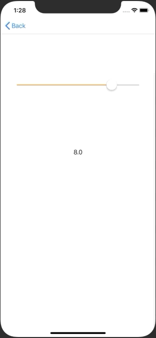

+++
title = "一定間隔の値をUISlider で取得する(Swift5.0)"
url = "2019-06-02"
date = "2019-06-02"
description = "一定間隔の値をUISlider で取得する(Swift5.0)"
tags = ["iOS", "Swift"]
categories = ["iOS", "Swift"]
archives = "2019/06"
+++

<br>

0, 0.5, 1.0, 1.5 …. と一定間隔の値をUISlider で取得するサンプルコードです。



<!-- Google Ads -->


<!-- Amazon Ads -->


<!--more-->

**UISliderRoundValue_20190523.swift**

```swift
import UIKit

class UISliderRoundValue_20190523: UIViewController {
    
    var sliderValue: UILabel!
    
    override func viewDidLoad() {
        super.viewDidLoad()
        
        view.backgroundColor = .white
        
        let initialValue: Float = 8.0
        let width = view.frame.width
        let height = view.frame.height
        
        let slider = UISlider()
        slider.minimumValue = 0.0
        slider.maximumValue = 10.0
        slider.value = initialValue
        slider.tintColor = .orange
        slider.frame = CGRect(x: width * 0.1, y: height * 0.2, width: width * 0.8, height: height * 0.1)
        slider.addTarget(self, action: #selector(sliderDidChangeValue(_:)), for: .valueChanged)
        view.addSubview(slider)
        
        sliderValue = UILabel()
        sliderValue.frame = CGRect(x: width * 0.1, y: height * 0.4, width: width * 0.8, height: height * 0.1)
        sliderValue.textAlignment = .center
        sliderValue.text = String(initialValue)
        view.addSubview(sliderValue)
    }
    
    @objc func sliderDidChangeValue(_ sender: UISlider) {
        let roundValue = roundf(sender.value * 2.0) * 0.5
        
        // set round value
        sender.value = roundValue
        sliderValue.text = String(roundValue)
    }
}

```

