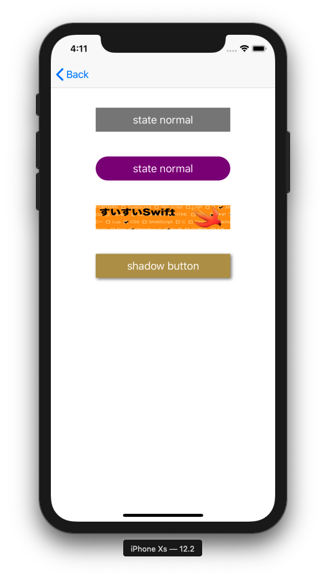

+++
title = "UIButton、ボタンを表示する(Swift5.0)"
url = "2019-06-03"
date = "2019-06-03"
description = "UIButton、ボタンを表示する(Swift5.0)"
tags = ["iOS", "Swift", "UIKit"]
categories = ["iOS"]
archives = "2019/06"
+++

<br>

UIButton を使ってボタンを表示するサンプルコードです。
角丸ボタンはよく使います。



<br>

<!--more-->

**UIButton_20190604.swift**

```swift
import UIKit

class UIButton_20190604: UIViewController {

    override func viewDidLoad() {
        super.viewDidLoad()
        
        view.backgroundColor = .white
        let width = view.frame.width
        let height = view.frame.height
        
        // make button instance
        let basicButton = UIButton()

        // set button size
        basicButton.frame = CGRect(x: width * 0.2, y: height * 0.15, width: width * 0.6, height: 40)

        // set background color
        basicButton.backgroundColor = UIColor.gray

        // set action
        basicButton.addTarget(self, action: #selector(buttonOnTap(sender:)), for: .touchUpInside)

        // set button title
        basicButton.setTitle("state normal", for: UIControl.State.normal)
        basicButton.setTitle("highlighted", for: UIControl.State.highlighted)

        // set button title color
        basicButton.setTitleColor(UIColor.white, for: UIControl.State.normal)

        // add view
        view.addSubview(basicButton)


        // make image button instance
        let cornerRadiusButton = UIButton()
        cornerRadiusButton.frame = CGRect(x: width * 0.2, y: height * 0.25, width: width * 0.6, height: 40)
        cornerRadiusButton.backgroundColor = UIColor.purple
        cornerRadiusButton.addTarget(self, action: #selector(cornerRadiusButtonOnTap(sender:)), for: .touchUpInside)
        cornerRadiusButton.setTitle("state normal", for: UIControl.State.normal)
        cornerRadiusButton.setTitle("highlighted", for: UIControl.State.highlighted)
        cornerRadiusButton.setTitleColor(UIColor.white, for: UIControl.State.normal)
        view.addSubview(cornerRadiusButton)

        // set corner radius
        cornerRadiusButton.layer.masksToBounds = true
        cornerRadiusButton.layer.cornerRadius = 20.0

        
        // make image button instance
        let imageButton = UIButton()
        imageButton.frame = CGRect(x: width * 0.2, y: height * 0.35, width: width * 0.6, height: 40)
        imageButton.backgroundColor = UIColor.orange
        imageButton.addTarget(self, action: #selector(imageButtonOnTap(sender:)), for: .touchUpInside)
        view.addSubview(imageButton);

        // set button background image
        let buttonImage = UIImage(named: "swiswiswift-banner")
        imageButton.setBackgroundImage(buttonImage, for: UIControl.State.normal)
        
        
        // shadow button
        let shadowButton = UIButton()
        shadowButton.frame = CGRect(x: width * 0.2, y: height * 0.45, width: width * 0.6, height: 40)
        shadowButton.setTitle("shadow button", for: UIControl.State.normal)
        shadowButton.backgroundColor = UIColor(red: 0.7, green: 0.6, blue: 0.3, alpha: 1)
        view.addSubview(shadowButton)
        
        // set shadow
        shadowButton.layer.shadowOpacity = 0.5
        shadowButton.layer.shadowOffset = CGSize(width: 2, height: 2)
    }

    // button on tap
    @objc func buttonOnTap(sender: UIButton) {
        print("button on tap")
    }

    // corner button on tap
    @objc func cornerRadiusButtonOnTap(sender: UIButton) {
        print("corner button on tap")
    }

    // image button on tap
    @objc func imageButtonOnTap(sender: UIButton) {
        print("image button on tap")
    }
}
```


<br>


<!-- Google Ads -->


<!-- Amazon Ads -->

