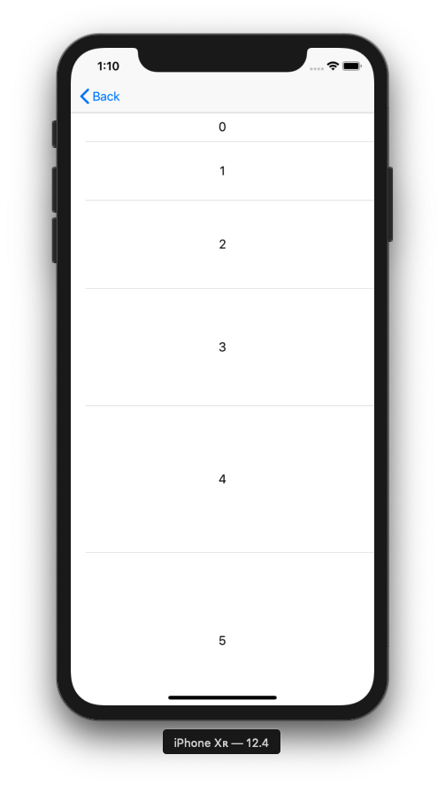

+++
title = "TableViewのセルの高さを変更する（Swift5.0.1）"
url = "2019-07-30"
date = "2019-07-30"
description = "TableViewのセルの高さを変更する（Swift5.0.1）"
tags = ["iOS", "Swift", "UIKit"]
categories = ["iOS", "Swift"]
archives = "2019/07"
+++

<br>

TableView のセルの高さを変更する方法です。  
一括で帰るときは .rowHeight を使い、個別に変えたいときは　heightForRowAt　を使うと実現できました。

サンプルコードはこちら。  
[https://github.com/takoikatakotako/swiswiswift-ios](https://github.com/takoikatakotako/swiswiswift-ios)




<!-- Google Ads -->


<!-- Amazon Ads -->



<br>

<!--more-->

**TableViewHeight_20190730.swift**

```swift
import UIKit

class TableViewHeight_20190730: UIViewController {
    
    private var tableView: UITableView!

    override func viewDidLoad() {
        super.viewDidLoad()

        tableView = UITableView()
        tableView.frame = view.bounds
        tableView.register(UITableViewCell.self, forCellReuseIdentifier: NSStringFromClass(UITableViewCell.self))
        tableView.dataSource = self
        tableView.delegate = self
        view.addSubview(tableView)
    }
}

extension TableViewHeight_20190730: UITableViewDataSource {
    func tableView(_ tableView: UITableView, numberOfRowsInSection section: Int) -> Int {
        return 6
    }
    
    func tableView(_ tableView: UITableView, cellForRowAt indexPath: IndexPath) -> UITableViewCell {
        let cell = tableView.dequeueReusableCell(withIdentifier: NSStringFromClass(UITableViewCell.self))! as UITableViewCell
        cell.textLabel?.text = "\(indexPath.row)"
        cell.textLabel?.textAlignment = .center
        return cell
    }
}

extension TableViewHeight_20190730: UITableViewDelegate {
    func tableView(_ tableView: UITableView, heightForRowAt indexPath: IndexPath) -> CGFloat {
        return CGFloat(40 * indexPath.row + 40)
    }
}
```

