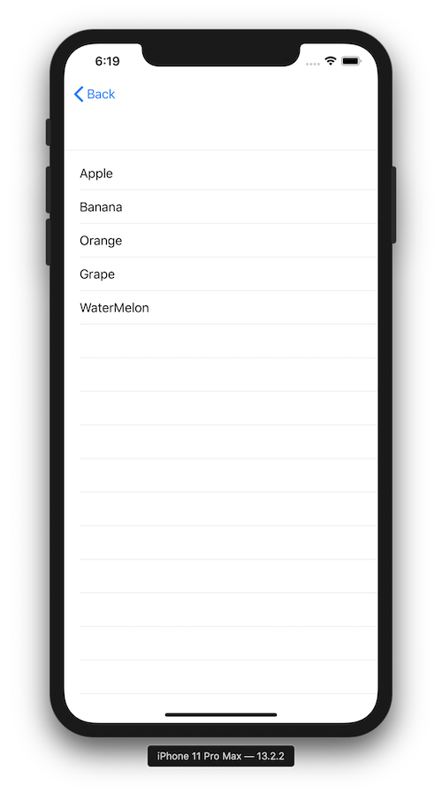

+++
title =  "SwiftUIでListを表示する"
url = "2019-11-13"
date = "2019-11-13"
description = "SwiftUIでListを表示する"
tags = ["iOS", "Swift", "SwiftUI"]
categories = ["iOS", "Swift"]
archives = "2019/11"
+++

<br>

SwiftUI でList を表示する方法です。
画面遷移後の画面なので、NavigationBar がいます。



<!-- Google Ads -->


<!-- Amazon Ads -->


<!--more-->

**ContentView.swift**

```swift
import SwiftUI

struct Fruit: Identifiable {
    var id: Int
    let name: String
}

struct ContentView: View {
    let fruits: [Fruit] = [
        Fruit(id: 0, name: "Apple"),
        Fruit(id: 1, name: "Banana"),
        Fruit(id: 2, name: "Orange"),
        Fruit(id: 3, name: "Grape"),
        Fruit(id: 4, name: "WaterMelon"),
    ]

    var body: some View {
        VStack {
            Divider()
            List (fruits) { fruit in
                Text(fruit.name)
            }
                .edgesIgnoringSafeArea([.bottom])
        }
    }
}

struct ContentView_Previews: PreviewProvider {
    static var previews: some View {
        ContentView()
    }
}
```

