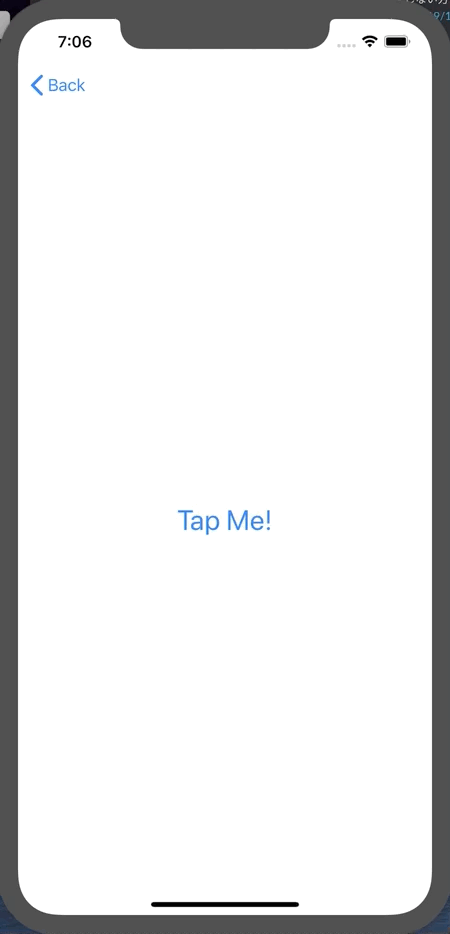
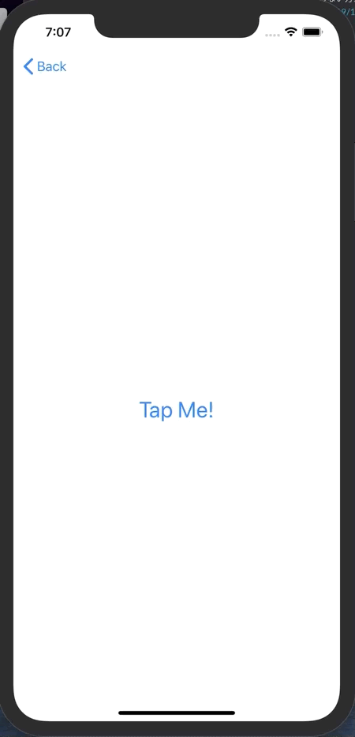

+++
title =  "SwiftUIでStructが使いまわされる"
url = "2019-11-14"
date = "2019-11-14"
description = "SwiftUIでStructが使いまわされる"
tags = ["iOS", "Swift", "SwiftUI"]
categories = ["iOS", "Swift"]
archives = "2019/11"
+++

<br>
画面遷移をするたびに異なる ID を表示させたかったのですが、それができませんでした。（毎回同じ ID が表示される）



`onDisappear` で id を再生成することで回避しました。  
`@State` に変化が無い場合はキャッシュを使い回したりするということでしょうか？   
勉強していきます！！



<!-- Google Ads -->


<!-- Amazon Ads -->


<!--more-->

**ContentView_20191114.swift**

```swift
import SwiftUI

struct ContentView_20191114: View {
    @State var id = UUID().uuidString
    var body: some View {
        VStack {
            NavigationLink(destination: DetailView_20191114(hoge: Hoge(id: id))) {
                Text("Tap Me!")
                    .font(.title)
            }
        }.onDisappear {
            self.id = UUID().uuidString
        }
    }
}

struct DetailView_20191114: View {
    var hoge: Hoge
    var body: some View {
        Text("id: \(hoge.id)")
    }
}

struct Hoge {
    var id: String
}

struct ContentView_20191114_Previews: PreviewProvider {
    static var previews: some View {
        ContentView_20191114()
    }
}
```


**ContentView_20191114_old.swift**

```swift
import SwiftUI

struct ContentView_20191114: View {
    var body: some View {
        VStack {
            NavigationLink(destination: DetailView_20191114(hoge: Hoge())) {
                Text("Tap Me!")
                    .font(.title)
            }
        }
    }
}

struct DetailView_20191114: View {
    var hoge: Hoge
    var body: some View {
        VStack {
            Text("id: \(hoge.id)")
        }
    }
}

struct Hoge {
    var id: String = UUID().uuidString
}


struct ContentView_20191114_Previews: PreviewProvider {
    static var previews: some View {
        ContentView_20191114()
    }
}
```

