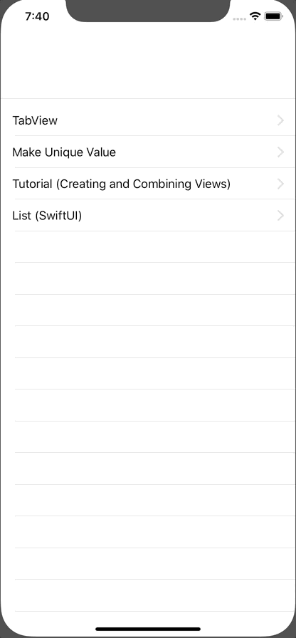

+++
title =  "ListViewからそれぞれ別のViewに遷移する（SwiftUI）"
url = "2019-11-20"
date = "2019-11-20"
description = "ListViewからそれぞれ別のViewに遷移する（SwiftUI）"
tags = ["iOS", "Swift", "SwiftUI"]
categories = ["iOS", "Swift", "SwiftUI"]
archives = "2019/11"
+++

<br>

設定画面のようにListViewからそれぞれ別のViewに遷移する方法が少し手間でした。  
もっと良い方法がある気がします。。。



<!-- Google Ads -->


<!-- Amazon Ads -->



<!--more-->

**ContentView.swift**

```swift
import SwiftUI

struct ContentView: View {
    var body: some View {
        NavigationView {
            VStack {
                Divider()
                List (samples) { sample in
                    self.containedView(sample: sample)
                }
                    .edgesIgnoringSafeArea([.bottom])
            }
        }
    }

    func containedView(sample: Sample) -> AnyView {
        switch sample.view {
        case .view_20191030: return AnyView(NavigationLink (destination: List_20191030()) {
                    Text(sample.title)
                })
        case .view_20191111: return AnyView(NavigationLink (destination: Tutorial_20191111()) {
                    Text(sample.title)
                })
        case .view_20191114: return AnyView(NavigationLink (destination: ContentView_20191114()) {
                    Text(sample.title)
                })
        case .view_20191120: return AnyView(NavigationLink (destination: ContentView_20191120()) {
                    Text(sample.title)
                })
        }
    }
}

struct ContentView_Previews: PreviewProvider {
    static var previews: some View {
        ContentView()
    }
}
```


**Samples.swift**

```swift
import SwiftUI

struct Sample: Identifiable {
    var id: Int
    var title: String
    var view: ViewEnum
}

enum ViewEnum {
    case view_20191120
    case view_20191114
    case view_20191111
    case view_20191030
}

let samples: [Sample] = [
    Sample(id: 20191120, title: "TabView", view: .view_20191120),
    Sample(id: 20191114, title: "Make Unique Value", view: .view_20191114),
    Sample(id: 20191111, title: "Tutorial (Creating and Combining Views)", view: .view_20191111),
    Sample(id: 20191030, title: "List (SwiftUI)", view: .view_20191030)
]
```

