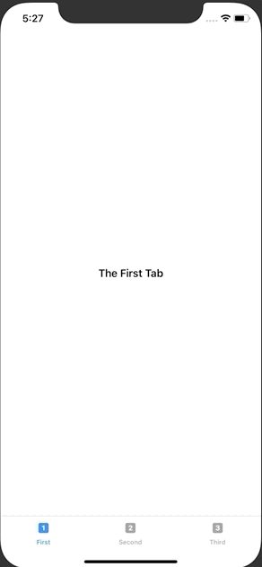

+++
title =  "TabViewを使って画面を切り替える（SwiftUI）"
url = "2019-11-21"
date = "2019-11-21"
description = "TabViewを使って画面を切り替える（SwiftUI）"
tags = ["iOS", "Swift", "SwiftUI"]
categories = ["iOS", "Swift", "SwiftUI"]
archives = "2019/11"
+++

<br>

TabViewを使って画面を切り替えるサンプルです。
かなり簡単に書くことができますね。

[TabView - SwiftUI | Apple Developer Documentation](https://developer.apple.com/documentation/swiftui/tabview)




<!-- Google Ads -->


<!-- Amazon Ads -->


<!--more-->

**ContentView.swift**

```swift
import SwiftUI

struct ContentView: View {
    var body: some View {
        TabView {
            Text("The First Tab")
                .tabItem {
                    Image(systemName: "1.square.fill")
                    Text("First")
            }
            Text("Another Tab")
                .tabItem {
                    Image(systemName: "2.square.fill")
                    Text("Second")
            }
            Text("The Last Tab")
                .tabItem {
                    Image(systemName: "3.square.fill")
                    Text("Third")
            }
        }
        .font(.headline)
    }
}

struct ContentView_Previews: PreviewProvider {
    static var previews: some View {
        ContentView()
    }
}
```

