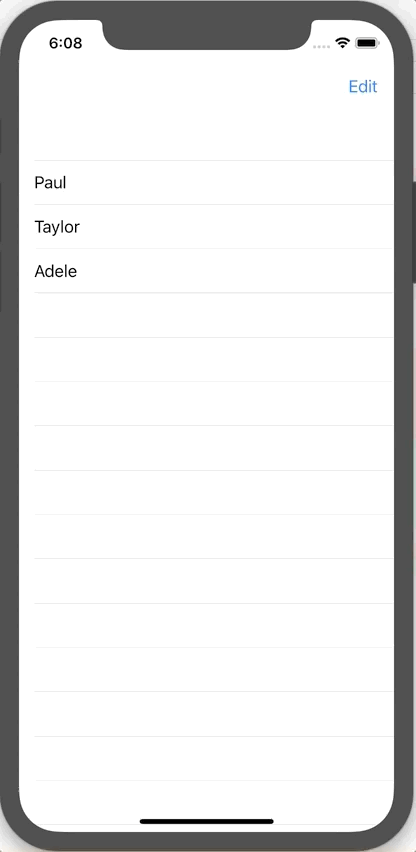

+++
title =  "SwiftUIでリストを編集する"
url = "2019-12-17"
date = "2019-12-17"
description = "SwiftUIでリストを編集する"
tags = ["Swift", "SwiftUI"]
categories = ["SwiftUI"]
archives = "2019/12"
+++

<br>

SwiftUIでリストを編集する方法です。
UITableView よりも短いコードで書くことができました。



参考: [How to enable editing on a list using EditButton](https://www.hackingwithswift.com/quick-start/swiftui/how-to-enable-editing-on-a-list-using-editbutton)

<!-- Google Ads -->


<!-- Amazon Ads -->


<!--more-->

**ContentView.swift**

```swift
import SwiftUI

struct ContentView: View {
    @State private var users = ["Paul", "Taylor", "Adele"]
    
    var body: some View {
        NavigationView {
            List {
                ForEach(users, id: \.self) { user in
                    Text(user)
                }
                .onDelete(perform: delete)
            }
            .navigationBarItems(trailing: EditButton())
        }
    }
    
    func delete(at offsets: IndexSet) {
        users.remove(atOffsets: offsets)
    }
}
struct ContentView_Previews: PreviewProvider {
    static var previews: some View {
        ContentView()
    }
}
```

