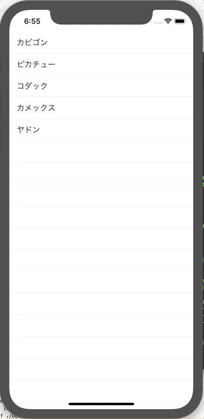

+++
title =  "SwiftUIでリストのセルをタップするとアラートが表示される方法"
url = "2019-12-18"
date = "2019-12-18"
description = "SwiftUIでリストのセルをタップするとアラートが表示される方法"
tags = ["Swift", "SwiftUI"]
categories = ["SwiftUI"]
archives = "2019/12"
+++

<br>

SwiftUI でリストのセルをタップするとアラートが表示される方法です。
まだまだ SwiftUI に慣れません。



<!-- Google Ads -->


<!-- Amazon Ads -->


<!--more-->

**ContentView.swift**

```swift
import SwiftUI

fileprivate struct Pokemon: Identifiable {
    let id = UUID()
    let name: String
}

struct ContentView: View {
    @State private var pokemons: [Pokemon] = [
        Pokemon(name: "カビゴン"),
        Pokemon(name: "ピカチュー"),
        Pokemon(name: "コダック"),
        Pokemon(name: "カメックス"),
        Pokemon(name: "ヤドン")]
    @State private var showingAlert = false
    
    var body: some View {
        List(pokemons) { pokemon in
            Button(action: {
                self.showingAlert = true
            }, label: {
                Text(pokemon.name)
            }).alert(isPresented: self.$showingAlert) {
                Alert(title: Text("ポケモン名"), message: Text(pokemon.name), dismissButton: .default(Text("閉じる")))
            }
        }
    }
}
struct ContentView_Previews: PreviewProvider {
    static var previews: some View {
        ContentView()
    }
}
```

