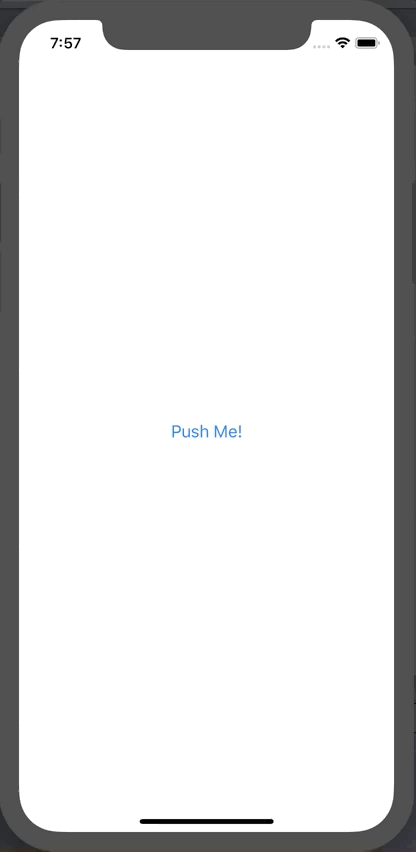

+++
title =  "SwiftUI でアラートを表示する"
url = "2019-12-20"
date = "2019-12-20"
description = "SwiftUI でアラートを表示する"
tags = ["Swift", "SwiftUI"]
categories = ["SwiftUI"]
archives = "2019/12"
+++

<br>

SwiftUI でアラートを表示する方法です。
UIAlertController とはかなり書き方が異なります。
`Property Wrapper` の `@State` がまだ慣れません。




<!-- Google Ads -->


<!-- Amazon Ads -->


<!--more-->

**ContentView.swift**

```swift
import SwiftUI

struct ContentView: View {
    @State var showingAlert = false
    var body: some View {
        Button(action: {
            self.showingAlert = true
        }, label: {
            Text("Push Me!")
        }).alert(isPresented: self.$showingAlert) {
            Alert(
                title: Text("タイトル"),
                message: Text("メッセージ"),
                primaryButton: .default(Text("ボタンその１")) {
                    print("ボタンその１")
                }, secondaryButton: .destructive(Text("ボタンその２")) {
                    print("ボタンその２")
                })
        }
    }
}
struct ContentView_Previews: PreviewProvider {
    static var previews: some View {
        ContentView()
    }
}
```

