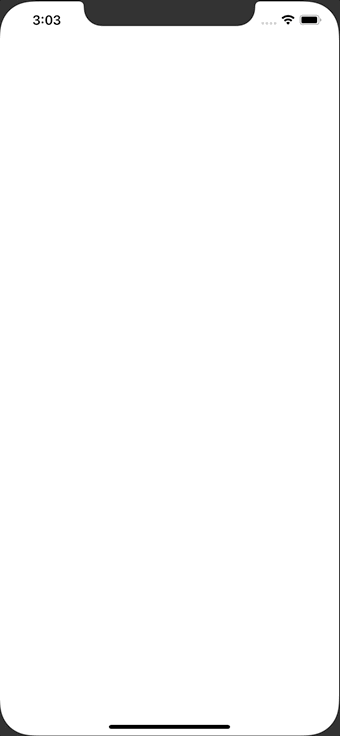

+++
title =  "MVPアーキテクチャを使ったサンプルアプリ"
url = "2019-12-30"
date = "2019-12-30"
description = "MVPアーキテクチャを使ったサンプルアプリ"
tags = ["Swift"]
categories = ["Swift"]
archives = "2019/12"
+++

<br>

MVPアーキテクチャを使ったサンプルアプリです。
Unitテスト、UIテストも書きました。

以下のような数字を足し合わせるアプリです。



リポジトリはこちら↓

[MVP-Sample](https://github.com/takoikatakotako/MVP-Sample)

<!-- Google Ads -->


<!-- Amazon Ads -->


<!--more-->

**MVPTests.swift**

```swift
import XCTest
@testable import MVP

class MVPTests: XCTestCase {
    
    func testExample() {
        
        class MockView: PresenterOutput {
            var presenter: PresenterInput!
            
            var buttonEnable: Bool = false
            var resultText: String = ""
            
            func inject(presenter: PresenterInput) {
                self.presenter = presenter
            }
            
            func changeResultButtonEnable(isEnable: Bool) {
                buttonEnable = isEnable
            }
            
            func setResultLabel(text: String) {
                resultText = text
            }
            
            func showErrorAlert(title: String, message: String) {
                print(title, message)
            }
        }
        
        let view = MockView()
        let model: ModelInput = Model()
        let presenter: PresenterInput = Presenter(view: view, model: model)
        view.inject(presenter: presenter)
        
        presenter.textDidChange(leftText: "4", rightText: "4")
        XCTAssertTrue(view.buttonEnable)
        
        presenter.resultButtonOnTap(leftText: "4", rightText: "4")
        XCTAssertEqual(view.resultText, "16.0")
    }
}
```


**MVPUITests.swift**

```swift
import XCTest

class MVPUITests: XCTestCase {
    override func setUp() {
        // In UI tests it is usually best to stop immediately when a failure occurs.
        continueAfterFailure = false
        
        // UI tests must launch the application that they test. Doing this in setup will make sure it happens for each test method.
        XCUIApplication().launch()
    }
    
    func testSampleListViewController_20190404() {
        
        let app = XCUIApplication()
        
        // 「Get 「=」 Button
        let resultButton = app.buttons["resultButton"]
        
        // 「=」 Button is disable
        XCTAssertFalse(resultButton.isEnabled)
        
        // Get LeftTestField
        let leftValueTextField = app.textFields["leftValueTextField"]
        
        // Focus LeftTestField
        leftValueTextField.tap()
        
        // Input 12
        leftValueTextField.typeText("12")
        
        // 「=」 Button is disable
        XCTAssertFalse(resultButton.isEnabled)
        
        // Get RightTestField
        let rightValueTextField = app.textFields["rightValueTextField"]
        
        // Focus RightTestField
        rightValueTextField.tap()
        
        // Input 4
        rightValueTextField.typeText("4")
        
        // 「=」 Button is enabled
        XCTAssertTrue(resultButton.isEnabled)
        
        // Tap 「=」 Button
        app.buttons["resultButton"].tap()
        
        let resultLabel = app.staticTexts["resultLabel"]
        
        // Assert resultLabel.label = 48
        XCTAssertEqual(resultLabel.label, "48.0")
    }
}
```


**Model.swift**

```swift
import Foundation

protocol ModelInput {
    func multiply(_ leftNumber: Float, _ rightNumber: Float) -> Float
}

class Model: ModelInput {
    func multiply(_ leftNumber: Float, _ rightNumber: Float) -> Float {
        return leftNumber * rightNumber
    }
}
```


**Presenter.swift**

```swift
import Foundation

protocol PresenterInput {
    func textDidChange(leftText: String, rightText: String)
    func resultButtonOnTap(leftText: String, rightText: String)
}

protocol PresenterOutput {
    func changeResultButtonEnable(isEnable: Bool)
    func setResultLabel(text: String)
    func showErrorAlert(title: String, message: String)
}

class Presenter: PresenterInput {
    let view: PresenterOutput
    let model: ModelInput
    
    init(view: PresenterOutput, model: ModelInput) {
        self.view = view
        self.model = model
    }
    
    func textDidChange(leftText: String, rightText: String) {
        if leftText.isEmpty || rightText.isEmpty {
            view.changeResultButtonEnable(isEnable: false)
        } else {
            view.changeResultButtonEnable(isEnable: true)
        }
    }
    
    func resultButtonOnTap(leftText: String, rightText: String) {
        guard let leftNumber = Float(leftText), let rightNumber = Float(rightText) else {
            view.showErrorAlert(title: "エラー", message: "数字を入れてください")
            return
        }
        view.setResultLabel(text: String(format: "%.1f", model.multiply(leftNumber, rightNumber)))
    }
}
```


**SceneDelegate.swift**

```swift
import UIKit

class SceneDelegate: UIResponder, UIWindowSceneDelegate {

    var window: UIWindow?


    func scene(_ scene: UIScene, willConnectTo session: UISceneSession, options connectionOptions: UIScene.ConnectionOptions) {
        guard let windowScene = (scene as? UIWindowScene) else { return }
        window = UIWindow(frame: UIScreen.main.bounds)
        let view = ViewController()
        let model = Model()
        let presenter = Presenter(view: view, model: model)
        view.inhect(presenter: presenter)
        
        window?.rootViewController = view
        window?.makeKeyAndVisible()
        window?.windowScene = windowScene
    }

    func sceneDidDisconnect(_ scene: UIScene) {
        // Called as the scene is being released by the system.
        // This occurs shortly after the scene enters the background, or when its session is discarded.
        // Release any resources associated with this scene that can be re-created the next time the scene connects.
        // The scene may re-connect later, as its session was not neccessarily discarded (see `application:didDiscardSceneSessions` instead).
    }

    func sceneDidBecomeActive(_ scene: UIScene) {
        // Called when the scene has moved from an inactive state to an active state.
        // Use this method to restart any tasks that were paused (or not yet started) when the scene was inactive.
    }

    func sceneWillResignActive(_ scene: UIScene) {
        // Called when the scene will move from an active state to an inactive state.
        // This may occur due to temporary interruptions (ex. an incoming phone call).
    }

    func sceneWillEnterForeground(_ scene: UIScene) {
        // Called as the scene transitions from the background to the foreground.
        // Use this method to undo the changes made on entering the background.
    }

    func sceneDidEnterBackground(_ scene: UIScene) {
        // Called as the scene transitions from the foreground to the background.
        // Use this method to save data, release shared resources, and store enough scene-specific state information
        // to restore the scene back to its current state.
    }
}
```


**ViewController.swift**

```swift
import UIKit

class ViewController: UIViewController {
    
    var presenter: PresenterInput!
    
    var leftValueTextField: UITextField!
    var rightValueTextField: UITextField!
    var resultButton: UIButton!
    var resultLabel: UILabel!
    
    func inhect(presenter: Presenter) {
        self.presenter = presenter
    }
    
    override func viewDidLoad() {
        super.viewDidLoad()
        
        view.backgroundColor = .white
        
        let width = view.frame.width
        
        leftValueTextField = UITextField()
        leftValueTextField.accessibilityIdentifier = "leftValueTextField"
        leftValueTextField.frame = CGRect(x: width * 0.05, y: 200, width: width * 0.4, height: 60)
        leftValueTextField.layer.borderWidth = 1
        leftValueTextField.addTarget(self, action: #selector(textFieldDidChange), for: .editingChanged)
        leftValueTextField.textAlignment = .center
        leftValueTextField.keyboardType = .numberPad
        view.addSubview(leftValueTextField)
        
        rightValueTextField = UITextField()
        rightValueTextField.accessibilityIdentifier = "rightValueTextField"
        rightValueTextField.frame = CGRect(x: width * 0.55, y: 200, width: width * 0.4, height: 60)
        rightValueTextField.layer.borderWidth = 1
        rightValueTextField.addTarget(self, action: #selector(textFieldDidChange), for: .editingChanged)
        rightValueTextField.textAlignment = .center
        rightValueTextField.keyboardType = .numberPad
        view.addSubview(rightValueTextField)
        
        resultButton = UIButton()
        resultButton.accessibilityIdentifier = "resultButton"
        resultButton.frame = CGRect(x: width * 0.2, y: 300, width: width * 0.6, height: 60)
        resultButton.setTitle("=", for: .normal)
        resultButton.setTitleColor(.black, for: .normal)
        resultButton.titleLabel?.font = UIFont.boldSystemFont(ofSize: 38)
        resultButton.isEnabled = false
        resultButton.layer.borderWidth = 1
        resultButton.addTarget(self, action: #selector(resultButtonOnTap), for: .touchDown)
        view.addSubview(resultButton)
        
        resultLabel = UILabel()
        resultLabel.accessibilityIdentifier = "resultLabel"
        resultLabel.frame = CGRect(x: width * 0.2, y: 400, width: width * 0.6, height: 60)
        resultLabel.textAlignment = .center
        view.addSubview(resultLabel)
    }
    
    @objc func textFieldDidChange() {
        guard let leftText = leftValueTextField.text, let rightText = rightValueTextField.text else {
            return
        }
        presenter.textDidChange(leftText: leftText, rightText: rightText)
    }
    
    @objc func resultButtonOnTap() {
        guard let leftText = leftValueTextField.text,  let rightText = rightValueTextField.text else {
            return
        }
        presenter.resultButtonOnTap(leftText: leftText, rightText: rightText)
    }
}

extension ViewController :PresenterOutput {
    func changeResultButtonEnable(isEnable: Bool) {
        resultButton.isEnabled = isEnable
    }
    
    func setResultLabel(text: String) {
        resultLabel.text = text
    }
    
    func showErrorAlert(title: String, message: String) {
        let actionAlert = UIAlertController(title: title, message: message, preferredStyle: UIAlertController.Style.alert)
        let cancelAction = UIAlertAction(title: "閉じる", style: UIAlertAction.Style.cancel, handler: nil)
        actionAlert.addAction(cancelAction)
        self.present(actionAlert, animated: true, completion: nil)        
    }
}
```

