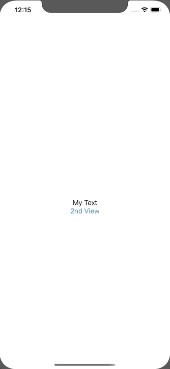

+++
title =  "SwiftUI で画面遷移先の View から遷移元のメソッドを呼び出す"
url = "2020-01-11"
date = "2020-01-11"
description = "SwiftUI で画面遷移先の View から遷移元のメソッドを呼び出す"
tags = ["Swift", "SwiftUI"]
categories = ["Swift", "SwiftUI"]
archives = "2020/01"
+++

<br>

SwiftUI で画面遷移先の View から遷移元のメソッドを呼び出すサンプルです。
delegate を使ったのですが、Combine で書いた方がよいかもしれません。



<!-- Google Ads -->


<!-- Amazon Ads -->


<!--more-->

**ContentView.swift**

```swift
import SwiftUI

struct ContentView: View, MyProtocol {
    @State var text: String = "My Text"
    var body: some View {
        NavigationView {
            VStack {
                Text(text)
                NavigationLink(destination: SecondView(delegate: self)) {
                    Text("2nd View")
                }
            }
        }
    }
    
    func myFunc() {
        text = "Changed Text"
    }
}

protocol MyProtocol {
    func myFunc()
}

struct SecondView: View {
    var delegate: MyProtocol
    var body: some View {
        Button(action: {
            self.delegate.myFunc()
        }) {
            Text("ChangeText")
        }
    }
}

struct ContentView_Previews: PreviewProvider {
    static var previews: some View {
        ContentView()
    }
}
```

