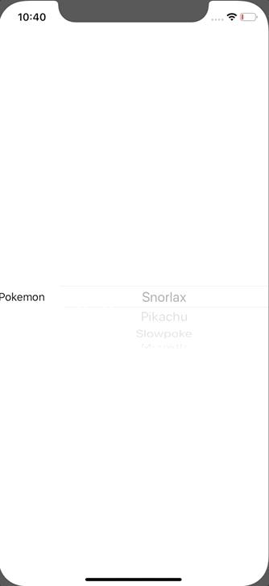

+++
title =  "SwiftUIでPicker を表示する"
url = "2020-01-12"
date = "2020-01-12"
description = "SwiftUIでPicker を表示する"
tags = ["Swift", "SwiftUI"]
categories = ["Swift", "SwiftUI"]
archives = "2020/01"
+++

<br>

SwiftUI で Picker を表示するサンプルです。
複数行の場合はこちらです。 [SwiftUIで複数行のPickerを作成する](/2020-01-14/)



参考: [Is there a way to call a function when a SwiftUI Picker selection changes?](https://stackoverflow.com/questions/58676483/is-there-a-way-to-call-a-function-when-a-swiftui-picker-selection-changes)  


<!-- Google Ads -->


<!-- Amazon Ads -->


<!--more-->

**ContentView.swift**

```swift
import SwiftUI

struct ContentView: View {
    var pokemons = ["Snorlax", "Pikachu", "Slowpoke", "Meowth"]
    @State private var selectedPokemon = 0
    
    var body: some View {
        Picker("Pokemon", selection: $selectedPokemon) {
            ForEach(0 ..< pokemons.count) {
                Text(self.pokemons[$0])
            }
        }.pickerStyle(WheelPickerStyle())
            .onReceive([self.selectedPokemon].publisher.first()) { (value) in
                print("selectedPokemon: \(value)")
                print(self.pokemons[value])
        }
    }
}

struct ContentView_Previews: PreviewProvider {
    static var previews: some View {
        ContentView()
    }
}
```

