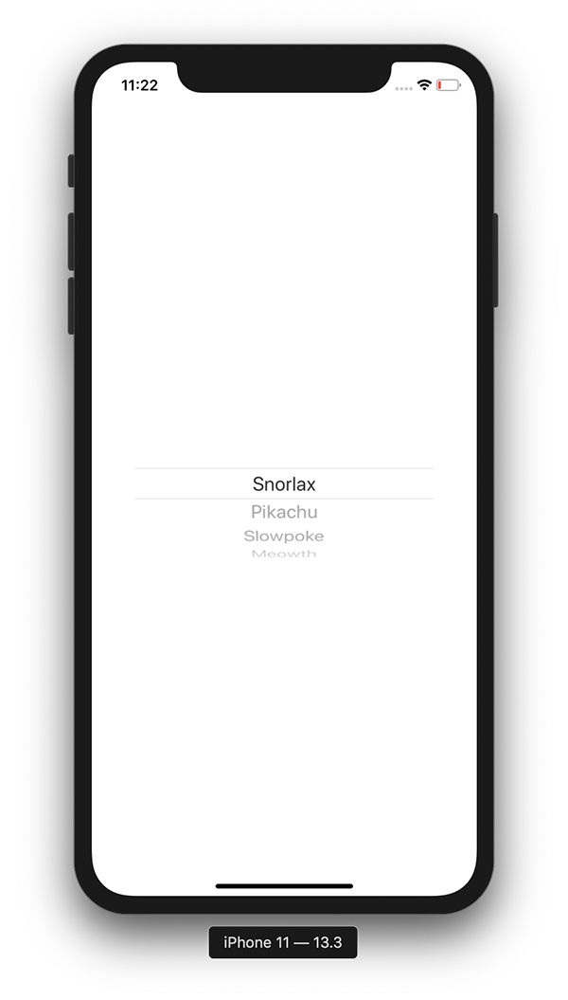

+++
title =  "SwiftUIのPickerでLabelを表示しない"
url = "2020-01-13"
date = "2020-01-13"
description = "SwiftUIのPickerでLabelを表示しない"
tags = ["Swift", "SwiftUI"]
categories = ["Swift", "SwiftUI"]
archives = "2020/01"
+++

<br>

SwiftUIのPickerでLabelを表示しない方法です。
`labelsHidden` を設定することで可能です。



参考: [How to hide the label of a Picker, Stepper, Toggle, and more using labelsHidden()](https://www.hackingwithswift.com/quick-start/swiftui/how-to-hide-the-label-of-a-picker-stepper-toggle-and-more-using-labelshidden)

<!-- Google Ads -->


<!-- Amazon Ads -->


<!--more-->

**ContentView.swift**

```swift
import SwiftUI

struct ContentView: View {
    var pokemons = ["Snorlax", "Pikachu", "Slowpoke", "Meowth"]
    @State private var selectedPokemon = 0
    
    var body: some View {
        Picker("Pokemon", selection: $selectedPokemon) {
            ForEach(0 ..< pokemons.count) {
                Text(self.pokemons[$0])
            }
        }.pickerStyle(WheelPickerStyle())
            .onReceive([self.selectedPokemon].publisher.first()) { (value) in
                print("selectedPokemon: \(value)")
                print(self.pokemons[value])
        }.labelsHidden()
    }
}

struct ContentView_Previews: PreviewProvider {
    static var previews: some View {
        ContentView()
    }
}
```

