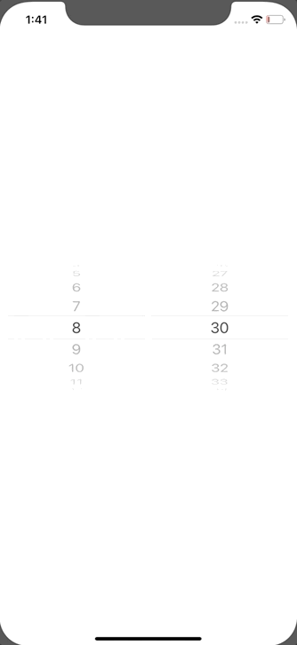

+++
title =  "SwiftUIで複数行のPickerを作成する"
url = "2020-01-14"
date = "2020-01-14"
description = "SwiftUIで複数行のPickerを作成する"
tags = ["Swift", "SwiftUI"]
categories = ["Swift", "SwiftUI"]
archives = "2020/01"
+++

<br>

UIPickerView のような複数行の Picker を作成する方法です。
UIPickerView と使い勝手がかなり異なり、戸惑いました。



参考: [Multi-Component Picker (UIPickerView) in SwiftUI](https://stackoverflow.com/questions/56567539/multi-component-picker-uipickerview-in-swiftui)

追記
iOS15では `compositingGroup` を追記する必要があります。


<!-- Google Ads -->


<!-- Amazon Ads -->


<!--more-->

**ContentView.swift**

```swift
import SwiftUI

struct ContentView: View {
    @State private var selectedHour = 8
    @State private var selectedMinute = 30
    
    var body: some View {
        GeometryReader { geometry in
            HStack {
                Picker(selection: self.$selectedHour, label: EmptyView()) {
                    ForEach(0 ..< 24) {
                        Text("\($0)")
                    }
                }.pickerStyle(WheelPickerStyle())
                    .onReceive([self.selectedHour].publisher.first()) { (value) in
                        print("hour: \(value)")
                }.labelsHidden()
                    .frame(width: geometry.size.width / 2, height: geometry.size.height)
                    .clipped()
                
                Picker(selection: self.$selectedMinute, label: EmptyView()) {
                    ForEach(0 ..< 60) {
                        Text("\($0)")
                    }
                }.pickerStyle(WheelPickerStyle())
                    .onReceive([self.selectedMinute].publisher.first()) { (value) in
                        print("minute: \(value)")
                }.labelsHidden()
                    .frame(width: geometry.size.width / 2, height: geometry.size.height)
                    .clipped()
            }
        }.padding()
    }
}

struct ContentView_Previews: PreviewProvider {
    static var previews: some View {
        ContentView()
    }
}
```

