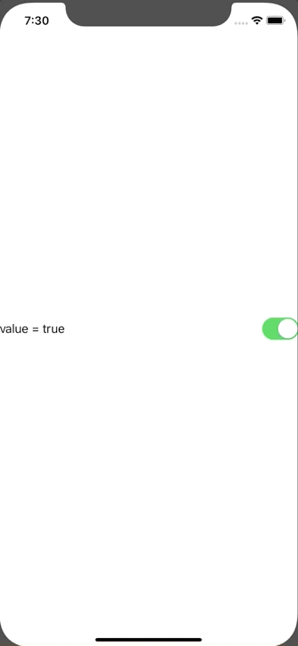

+++
title =  "SwiftUIのToggleの変更を検知する"
url = "2020-02-05"
date = "2020-02-05"
description = "SwiftUIのToggleの変更を検知する"
tags = ["Swift", "SwiftUI"]
categories = ["Swift", "SwiftUI"]
archives = "2020/02"
+++

<br>

SwiftUIのToggleの変更を検知し、print 文を実行します。



参考: [How can I trigger an action when a swiftUI toggle() is toggled?](https://stackoverflow.com/questions/56996272/how-can-i-trigger-an-action-when-a-swiftui-toggle-is-toggled)

<!-- Google Ads -->


<!-- Amazon Ads -->


<!--more-->

**ContentView.swift**

```swift
import SwiftUI

class ContentViewViewModel: ObservableObject {
    @Published var toggleValue: Bool = true {
        didSet {
            print("value did change")
        }
    }
}

struct ContentView: View {
    @ObservedObject(initialValue: ContentViewViewModel()) var viewModel: ContentViewViewModel
    var body: some View {
        Toggle(isOn: $viewModel.toggleValue) {
            HStack {
                Text("value = " + String(viewModel.toggleValue))
            }
        }
    }
}

struct ContentView_Previews: PreviewProvider {
    static var previews: some View {
        ContentView()
    }
}
```

