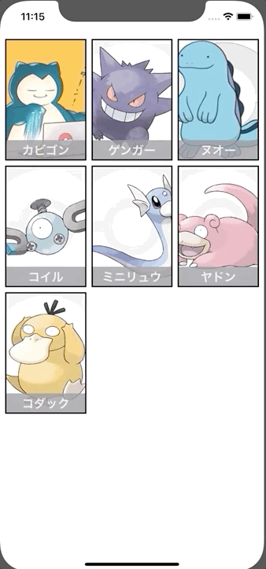

+++
title =  "SwiftUIでUICollectionViewのようにViewを並べる"
url = "2020-02-09"
date = "2020-02-09"
description = "SwiftUIでUICollectionViewのようにViewを並べる"
tags = ["Swift", "SwiftUI"]
categories = ["Swift", "SwiftUI"]
archives = "2020/02"
+++

<br>

SwiftUI で UICollectionView のように表示する方法です。
[Q-Mobile/QGrid](https://github.com/Q-Mobile/QGrid) というライブラリを使うと簡単です。
QGrid を参考にしながら書いてみました。



参考: [Q-Mobile/QGrid](https://github.com/Q-Mobile/QGrid)

<!-- Google Ads -->


<!-- Amazon Ads -->


<!--more-->

**ContentView.swift**

```swift
import SwiftUI

struct Pokemon: Identifiable {
    let id = UUID()
    let name: String
    let imageName: String
}

struct PokemonCell: View {
    let pokemon: Pokemon
    var body: some View {
        ZStack {
            Image(pokemon.imageName)
                .resizable()
                .aspectRatio(contentMode: .fill)
            VStack {
                Spacer()
                Text(pokemon.name)
                    .font(Font.system(size: 20.0).bold())
                    .frame(maxWidth: .infinity, maxHeight: 32)
                    .background(Color.gray)
                    .foregroundColor(Color.white)
                    .opacity(0.8)
            }
        }
    }
}

struct ContentView: View {
    
    let columns: Int = 3
    let pokemons = [
        Pokemon(name: "カビゴン", imageName: "snorlax"),
        Pokemon(name: "ゲンガー", imageName: "gengar"),
        Pokemon(name: "ヌオー", imageName: "quagsire"),
        Pokemon(name: "コイル", imageName: "magnemite"),
        Pokemon(name: "ミニリュウ", imageName: "dratini"),
        Pokemon(name: "ヤドン", imageName: "slowpoke"),
        Pokemon(name: "コダック", imageName: "psyduck"),
    ]
    var body: some View {
        GeometryReader { geometry in
            ScrollView(showsIndicators: false) {
                ForEach(0..<self.pokemons.count/self.columns) { rowIndex in
                    HStack {
                        ForEach(0..<self.columns) { columnIndex in
                            self.getPokemonCell(
                                pokemon: self.getPokemon(rowIndex: rowIndex, columnIndex: columnIndex),
                                width: self.cellWidth(width: geometry.size.width),
                                height: self.cellHeight(width: geometry.size.width))
                        }
                    }
                }
                
                if (self.pokemons.count % self.columns > 0) {
                    HStack {
                        ForEach(0..<self.pokemons.count % self.columns) { lastColumnIndex in
                            self.getPokemonCell(
                                pokemon: self.getPokemon(lastColumnIndex: lastColumnIndex),
                                width: self.cellWidth(width: geometry.size.width),
                                height: self.cellHeight(width: geometry.size.width))
                        }
                        Spacer()
                    }
                }
            }
        }.padding()
    }
    
    
    private func getPokemon(rowIndex: Int, columnIndex: Int) -> Pokemon {
        return pokemons[columns * rowIndex + columnIndex]
    }
    
    private func getPokemon(lastColumnIndex: Int) -> Pokemon {
        return self.pokemons[self.columns * (self.pokemons.count / self.columns) + lastColumnIndex]
    }
    
    
    private func cellWidth(width: CGFloat) -> CGFloat {
        return width / CGFloat(columns)
    }
    
    private func cellHeight(width: CGFloat) -> CGFloat {
        return cellWidth(width: width) * 1.5
    }
    
    private func getPokemonCell(pokemon: Pokemon, width: CGFloat, height: CGFloat) -> AnyView {
        return AnyView(PokemonCell(pokemon: pokemon)
            .frame(width: width,
                   height: height)
            .border(Color.black, width: 2)
            .clipped())
    }
}

struct ContentView_Previews: PreviewProvider {
    static var previews: some View {
        ContentView()
    }
}
```

