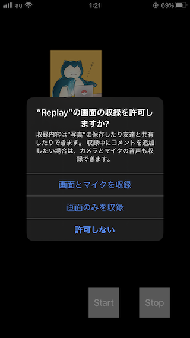

+++
title =  "ReplayKitを使って画面を録音する"
url = "2020-02-12"
date = "2020-02-12"
description = "ReplayKitを使って画面を録音する"
tags = ["Swift"]
categories = ["Swift"]
archives = "2020/02"
+++

<br>

ReplayKit を使うと画面を録画することができます。
凄く簡単に使うことができる上に、マイクで実況？をしたりすることができます。
今回は動画として保存しましたが、WebRTC と組み合わせたりと、いろいろなことに使うことができます。



<!-- Google Ads -->


<!-- Amazon Ads -->


<!--more-->

**ViewController.swift**

```swift
import UIKit
import ReplayKit

class ViewController: UIViewController {
    
    let recorder = RPScreenRecorder.shared()
    var iconImageView = UIImageView()
    
    override func viewDidLoad() {
        super.viewDidLoad()
        iconImageView.image = UIImage(named: "icon")
        iconImageView.frame = CGRect(x: 100, y: 100, width: 100, height: 100)
        view.addSubview(iconImageView)
        
        let startRecordButton = UIButton()
        startRecordButton.setTitle("Start", for: .normal)
        startRecordButton.backgroundColor = .lightGray
        startRecordButton.frame = CGRect(x: view.bounds.size.width - 200, y: view.bounds.size.height - 100, width: 60, height: 60)
        startRecordButton.addTarget(self, action: #selector(startRecording), for: .touchDown)
        view.addSubview(startRecordButton)
        
        let stopRecordButton = UIButton()
        stopRecordButton.setTitle("Stop", for: .normal)
        stopRecordButton.backgroundColor = .lightGray
        stopRecordButton.frame = CGRect(x: view.bounds.size.width - 100, y: view.bounds.size.height - 100, width: 60, height: 60)
        stopRecordButton.addTarget(self, action: #selector(startRecording), for: .touchDown)
        view.addSubview(stopRecordButton)
        
        recorder.isMicrophoneEnabled = true
    }
    
    override func touchesBegan(_ touches: Set<UITouch>, with event: UIEvent?) {
        if let touch = touches.first {
            let point = touch.location(in: self.view)
            iconImageView.center = point
        }
    }
    
    override open func touchesMoved(_ touches: Set<UITouch>, with event: UIEvent?) {
        if let touch = touches.first {
            let point = touch.location(in: self.view)
            iconImageView.center = point
        }
    }
    
    override open func touchesEnded(_ touches: Set<UITouch>, with event: UIEvent?) {
        if let touch = touches.first {
            let point = touch.location(in: self.view)
            iconImageView.center = point
        }
    }
    
    @objc func startRecording() {
        recorder.startRecording { (error) in
            if let error = error {
                print(error)
            }
        }
    }

    @objc func endRecording() {
        recorder.stopRecording { (previewVC, error) in
            if let previewVC = previewVC {
                previewVC.previewControllerDelegate = self
                self.present(previewVC, animated: true)
            }
            
            if let error = error {
                print(error)
            }
        }
    }
}

extension UIViewController: RPPreviewViewControllerDelegate {
    public func previewControllerDidFinish(_ previewController: RPPreviewViewController) {
        dismiss(animated: true, completion: nil)
    }
}
```

