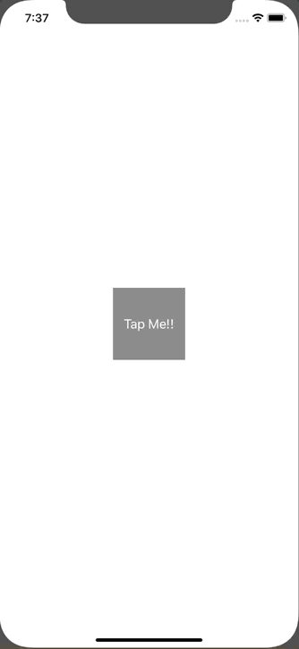

+++
title =  "UIViewの背景をグリッドにしたり、ドットにしたりする"
url = "2020-02-14"
date = "2020-02-14"
description = "UIViewの背景をグリッドにしたり、ドットにしたりする"
tags = ["iOS", "Swift", "UIKit"]
categories = ["Swift"]
archives = "2020/02"
+++

<br>

UIView の背景をグリッドにしたり、ドットにしたりする方法です。
今回は GridView という UIView のサブクラスを作り、ボタンを押すことでドットが切り替わるようにしました。



<!-- Google Ads -->


<!-- Amazon Ads -->


<!--more-->

**GridStyle.swift**

```swift
import Foundation

enum GridStyle {
    case none
    case grid
    case dot
}
```


**GridView.swift**

```swift
import UIKit

class GridView: UIView {
    var gridStyle: GridStyle = .none
    let gridWidth: CGFloat = 20
    
    func setGrid(gridStyle: GridStyle) {
        self.gridStyle = gridStyle
        switch gridStyle {
        case .none:
            clear()
            
        case .grid:
            clear()
            drawGrid()
            
        case .dot:
            clear()
            drawDot()
        }
    }
    
    private func clear() {
        guard let layers = self.layer.sublayers else {
            return
        }
        for layer in layers {
            layer.removeFromSuperlayer()
        }
    }
    
    private func drawGrid() {
        let gridPath = UIBezierPath()

        // Horizontal
        var pointLeft = CGPoint(x: 0, y: gridWidth)
        var pointRight = CGPoint(x: bounds.size.width, y: gridWidth)
        while pointLeft.y < bounds.height {
            gridPath.move(to: pointLeft)
            gridPath.addLine(to: pointRight)
            pointLeft.y = pointLeft.y + gridWidth
            pointRight.y = pointRight.y + gridWidth
        }
        
        // Vertical
        var pointTop = CGPoint(x: gridWidth, y: 0)
        var pointBottom = CGPoint(x: gridWidth, y: bounds.size.height)
        while pointTop.x < bounds.width {
            gridPath.move(to: pointTop)
            gridPath.addLine(to: pointBottom)
            pointTop.x = pointTop.x + gridWidth
            pointBottom.x = pointBottom.x + gridWidth
        }
        
        let gridLayer = CAShapeLayer()
        gridLayer.frame = bounds
        gridLayer.path = gridPath.cgPath
        gridLayer.strokeColor = UIColor.black.cgColor
        gridLayer.lineWidth = 0.4
        layer.addSublayer(gridLayer)
    }
    
    private func drawDot() {
        let dotPath = UIBezierPath()
        var point = CGPoint(x: gridWidth, y: gridWidth)
        while point.x < bounds.width {
            while point.y < bounds.height {
                dotPath.move(to: point)
                dotPath.addArc(withCenter: point, radius: 1, startAngle: 0, endAngle: .pi * 2, clockwise: true)
                point.y = point.y + gridWidth
            }
            point.x = point.x + gridWidth
            point.y = gridWidth
        }
        
        let dotLayer = CAShapeLayer()
        dotLayer.frame = bounds
        dotLayer.path = dotPath.cgPath
        dotLayer.fillColor = UIColor.black.cgColor
        layer.addSublayer(dotLayer)
    }
}
```


**ViewController.swift**

```swift
import UIKit

class ViewController: UIViewController {
    var gridView: GridView = GridView()
    
    override func viewDidLoad() {
        super.viewDidLoad()
        
        gridView.frame = view.bounds
        view.addSubview(gridView)
        
        let button = UIButton()
        button.addTarget(self, action: #selector(changeGrid), for: .touchUpInside)
        button.setTitle("Tap Me!!", for: .normal)
        button.backgroundColor = .gray
        button.frame.size = CGSize(width: 100, height: 100)
        button.center = view.center
        view.addSubview(button)
    }
    
    @objc func changeGrid() {
        switch gridView.gridStyle {
        case .none:
            gridView.setGrid(gridStyle: .grid)
        case .grid:
            gridView.setGrid(gridStyle: .dot)
        case .dot:
            gridView.setGrid(gridStyle: .none)
        }
    }
}
```

