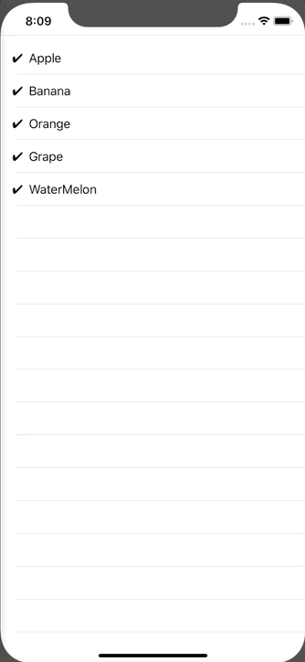

+++
title =  "タップでListViewにチェックを入れる"
url = "2020-02-17"
date = "2020-02-17"
description = "タップでListViewにチェックを入れる"
tags = ["Swift", "SwiftUI"]
categories = ["Swift"]
archives = "2020/02"
+++

<br>

タップで ListView にチェックを入れるサンプルです。
タップすることで State が変化し、✔︎を描画するようになります。




<!-- Google Ads -->


<!-- Amazon Ads -->


<!--more-->

**ContentView.swift**

```swift
import SwiftUI

struct Fruit: Identifiable, Equatable {
    let id: Int
    var check: Bool
    var name: String
}

struct ListRow: View {
    let check: Bool
    let name: String
    var body: some View {
        HStack {
            if check {
                Text("✔︎")
            } else {
                Text(" ")
            }
            Text(name)
            Spacer()
        }
    }
}

struct ContentView: View {
    @State var fruits: [Fruit] = [
        Fruit(id: 0, check: true, name: "Apple"),
        Fruit(id: 1, check: true, name: "Banana"),
        Fruit(id: 2, check: true, name: "Orange"),
        Fruit(id: 3, check: true, name: "Grape"),
        Fruit(id: 4, check: true, name: "WaterMelon"),
    ]
    
    var body: some View {
        VStack {
            Divider()
            List (fruits) { fruit in
                Button(action: {
                    guard let index = self.fruits.firstIndex(of: fruit) else {
                        return
                    }
                    self.fruits[index].check.toggle()
                }) {
                    ListRow(check: fruit.check, name: fruit.name)
                }
            }
            .edgesIgnoringSafeArea([.bottom])
        }
    }
}

struct ContentView_Previews: PreviewProvider {
    static var previews: some View {
        ContentView()
    }
}
```

