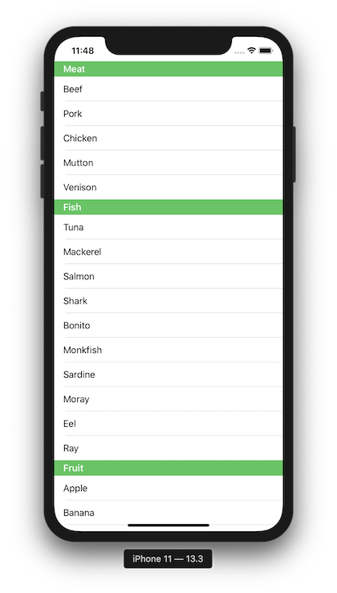

+++
title =  "SwiftUIのListのSectionの色を変える"
url = "2020-02-19"
date = "2020-02-19"
description = "SwiftUIのListのSectionの色を変える"
tags = ["Swift", "SwiftUI"]
categories = ["Swift"]
archives = "2020/02"
+++

<br>

SwiftUIのListのSectionの色を変えるサンプルです。
Appearanceを使って背景色を変えている記事がいくつかありますが、以下の方法でもできました。
 
[Remove/change section header background color in SwiftUI List](https://stackoverflow.com/questions/56867334/remove-change-section-header-background-color-in-swiftui-list)




<!-- Google Ads -->


<!-- Amazon Ads -->


<!--more-->

**ContentView.swift**

```swift
import SwiftUI

struct ContentView: View {
    @State var foodTypes: [FoodType] = [
        FoodType(
            name: "Meat",
            foods: [
                Food(check: true, name: "Beef"),
                Food(check: true, name: "Pork"),
                Food(check: true, name: "Chicken"),
                Food(check: true, name: "Mutton"),
                Food(check: true, name: "Venison"),
            ]
        ),
        FoodType(
            name: "Fish",
            foods: [
                Food(check: true, name: "Tuna"),
                Food(check: true, name: "Mackerel"),
                Food(check: true, name: "Salmon"),
                Food(check: true, name: "Shark"),
                Food(check: true, name: "Bonito"),
                Food(check: true, name: "Monkfish"),
                Food(check: true, name: "Sardine"),
                Food(check: true, name: "Moray"),
                Food(check: true, name: "Eel"),
                Food(check: true, name: "Ray"),
            ]
        ),
        FoodType(
            name: "Fruit",
            foods: [
                Food(check: true, name: "Apple"),
                Food(check: true, name: "Banana"),
                Food(check: true, name: "Orange"),
                Food(check: true, name: "Peach"),
            ]
        )
    ]
    
    var body: some View {
        List {
            ForEach(0 ..< self.foodTypes.count) { foodTypeIndex in
                Section(header:
                    SectionHeader(text: self.foodTypes[foodTypeIndex].name)
                ) {
                    ForEach(0 ..< self.foodTypes[foodTypeIndex].foods.count) { foodIndex in
                        Text(self.foodTypes[foodTypeIndex].foods[foodIndex].name)
                    }
                }
            }
        }
        .edgesIgnoringSafeArea([.bottom])
    }
}

struct FoodType: Identifiable, Equatable {
    let id: UUID = UUID()
    var name: String
    var foods: [Food]
}

struct Food: Identifiable, Equatable {
    let id: UUID = UUID()
    var check: Bool
    var name: String
}

struct SectionHeader: View {
    let text: String
    var body: some View {
        Text(text)
            .padding()
            .frame(width: UIScreen.main.bounds.width, height: 28,alignment: .leading)
            .background(Color.green)
            .foregroundColor(Color.white)
    }
}

struct ContentView_Previews: PreviewProvider {
    static var previews: some View {
        ContentView()
    }
}
```

