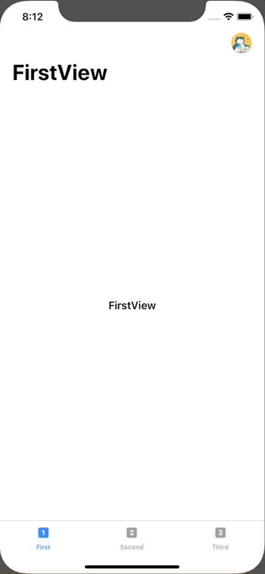

+++
title =  "SwiftUIでSwiftUIでサイドメニュー（ハンバーガーメニュー）を表示する"
url = "2020-02-20"
date = "2020-02-20"
description = "SwiftUIでSwiftUIでサイドメニュー（ハンバーガーメニュー）を表示する"
tags = ["Swift", "SwiftUI"]
categories = ["Swift"]
archives = "2020/02"
+++

<br>

SwiftUIでサイドメニュー（ハンバーガーメニュー）を表示するサンプルです。
ドラッグで消す箇所などいくつか妥協しました。もっと良いサイドメニューをかけたら再度記事を投稿します。

[How To Create A Side Menu (Hamburger Menu) In SwiftUI](https://blckbirds.com/post/side-menu-hamburger-menu-in-swiftui/)




<!-- Google Ads -->


<!-- Amazon Ads -->


<!--more-->

**ContentView.swift**

```swift
import SwiftUI

struct ContentView: View {
    @EnvironmentObject var appState: AppState
    var body: some View {
        GeometryReader { geometry in
            ZStack {
                RootView()
                    .frame(width: geometry.size.width, height: geometry.size.height)
                    .offset(x: self.appState.isMenuShowing ? -200 : 0)
                    .disabled(self.appState.isMenuShowing ? true : false)
                
                Color.gray
                    .edgesIgnoringSafeArea(.all)
                    .opacity(self.appState.isMenuShowing ? 0.3 : 0)
                
                if self.appState.isMenuShowing {
                    
                    MenuView()
                        .frame(width: geometry.size.width)
                        .transition(.move(edge: .trailing))
                }
            }
        }
    }
}

struct ContentView_Previews: PreviewProvider {
    static var previews: some View {
        ContentView()
    }
}
```


**FirstView.swift**

```swift
import SwiftUI

struct FirstView: View {
    @EnvironmentObject var appState: AppState
    var body: some View {
        NavigationView {
            Text("FirstView")
                .navigationBarTitle("FirstView")
                .navigationBarItems(trailing:
                    Button (action: {
                        withAnimation(.easeInOut(duration: 0.2)) {
                            self.appState.isMenuShowing = true
                        }
                    }) {
                        Image("icon")
                            .renderingMode(.original)
                            .resizable().frame(width: 32, height: 32).cornerRadius(16)
                })
        }
    }
}

struct FirstView_Previews: PreviewProvider {
    static var previews: some View {
        FirstView()
    }
}
```


**MenuView.swift**

```swift
import SwiftUI
import UIKit

struct MenuView: View {
    @EnvironmentObject var appState: AppState
    
    var body: some View {
        let drag = DragGesture()
            .onChanged() {gesture in
                // Drag Left to Right
                if ((gesture.location.x - gesture.startLocation.x) > 0) {
                    withAnimation(.easeInOut(duration: 0.2)) {
                        self.appState.isMenuShowing = false
                    }
                }
        }
        
        return ZStack {
            HStack {
                Button(action: {
                    withAnimation(.easeInOut(duration: 0.2)) {
                        self.appState.isMenuShowing = false
                    }
                }) {
                    HStack {
                        Spacer()
                        VStack {
                            Spacer()
                        }
                    }
                }
                
                VStack(alignment: .leading) {
                    HStack {
                        Image(systemName: "person")
                            .foregroundColor(.gray)
                            .imageScale(.large)
                        Text("Profile")
                            .foregroundColor(.gray)
                            .font(.headline)
                        Spacer()
                    }
                    .padding()
                    .padding(.top, 60)
                    HStack {
                        Image(systemName: "envelope")
                            .foregroundColor(.gray)
                            .imageScale(.large)
                        Text("Messages")
                            .foregroundColor(.gray)
                            .font(.headline)
                        Spacer()
                    }
                    .padding()
                    HStack {
                        Image(systemName: "gear")
                            .foregroundColor(.gray)
                            .imageScale(.large)
                        Text("Settings")
                            .foregroundColor(.gray)
                            .font(.headline)
                        Spacer()
                    }
                    .padding()
                    Spacer()
                }
                .frame(width: 300)
                .background(Color.white)
                .gesture(drag)
            }
        }
        .edgesIgnoringSafeArea(.all)
        .background(Color.clear)
    }
}

struct MenuView_Previews: PreviewProvider {
    static var previews: some View {
        MenuView()
    }
}
```


**RootView.swift**

```swift
import SwiftUI

struct RootView: View {
    @EnvironmentObject var appState: AppState
    var body: some View {
        TabView {
            FirstView()
                .tabItem {
                    Image(systemName: "1.square.fill")
                    Text("First")
            }
            SecondView()
                .tabItem {
                    Image(systemName: "2.square.fill")
                    Text("Second")
            }
            ThirdView()
                .tabItem {
                    Image(systemName: "3.square.fill")
                    Text("Third")
            }
        }
        .font(.headline)
    }
}

struct RootView_Previews: PreviewProvider {
    static var previews: some View {
        RootView()
    }
}
```


**SceneDelegate.swift**

```swift
import UIKit
import SwiftUI

class SceneDelegate: UIResponder, UIWindowSceneDelegate {

    var window: UIWindow?

    func scene(_ scene: UIScene, willConnectTo session: UISceneSession, options connectionOptions: UIScene.ConnectionOptions) {
        // Use this method to optionally configure and attach the UIWindow `window` to the provided UIWindowScene `scene`.
        // If using a storyboard, the `window` property will automatically be initialized and attached to the scene.
        // This delegate does not imply the connecting scene or session are new (see `application:configurationForConnectingSceneSession` instead).

        // Create the SwiftUI view that provides the window contents.
        let contentView = ContentView()

        // AppState
        let appState = AppState()
        
        // Use a UIHostingController as window root view controller.
        if let windowScene = scene as? UIWindowScene {
            let window = UIWindow(windowScene: windowScene)
            window.rootViewController = UIHostingController(rootView: contentView.environmentObject( appState ))
            self.window = window
            window.makeKeyAndVisible()
        }
    }

    func sceneDidDisconnect(_ scene: UIScene) {
        // Called as the scene is being released by the system.
        // This occurs shortly after the scene enters the background, or when its session is discarded.
        // Release any resources associated with this scene that can be re-created the next time the scene connects.
        // The scene may re-connect later, as its session was not neccessarily discarded (see `application:didDiscardSceneSessions` instead).
    }

    func sceneDidBecomeActive(_ scene: UIScene) {
        // Called when the scene has moved from an inactive state to an active state.
        // Use this method to restart any tasks that were paused (or not yet started) when the scene was inactive.
    }

    func sceneWillResignActive(_ scene: UIScene) {
        // Called when the scene will move from an active state to an inactive state.
        // This may occur due to temporary interruptions (ex. an incoming phone call).
    }

    func sceneWillEnterForeground(_ scene: UIScene) {
        // Called as the scene transitions from the background to the foreground.
        // Use this method to undo the changes made on entering the background.
    }

    func sceneDidEnterBackground(_ scene: UIScene) {
        // Called as the scene transitions from the foreground to the background.
        // Use this method to save data, release shared resources, and store enough scene-specific state information
        // to restore the scene back to its current state.
    }
}
```


**SecondView.swift**

```swift
import SwiftUI

struct SecondView: View {
    var body: some View {
        NavigationView {
            Text("SecondView")
                .navigationBarTitle("SecondView")
        }
    }
}

struct SecondView_Previews: PreviewProvider {
    static var previews: some View {
        SecondView()
    }
}
```


**ThirdView.swift**

```swift
import SwiftUI

struct ThirdView: View {
    var body: some View {
        NavigationView {
            Text("ThirdView")
                .navigationBarTitle("ThirdView")
        }
    }
}

struct ThirdView_Previews: PreviewProvider {
    static var previews: some View {
        ThirdView()
    }
}
```

