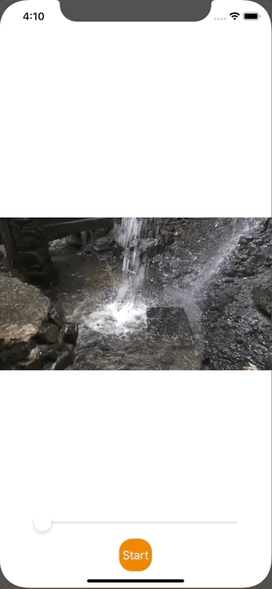

+++
title =  "Swiftで動画を再生する"
url = "2020-02-21"
date = "2020-02-21"
description = "Swiftで動画を再生する"
tags = ["Swift"]
categories = ["Swift"]
archives = "2020/02"
+++

<br>

Swiftで動画を再生するサンプルです。
動画はこちらのサイトからお借りしました。

[Hybrid Creative Movies SAKURA](https://www.home-movie.biz/free_movie.html)

こちらのサイトを参考にさせて頂きました。

[動画の再生](https://docs.fabo.io/swift/avfoundation/006_avfoundation.html)



<!-- Google Ads -->


<!-- Amazon Ads -->


<!--more-->

**ViewController.swift**

```swift
import UIKit
import AVFoundation

class ViewController: UIViewController {
    var videoPlayer: AVPlayer!
    lazy var seekBar = UISlider()
    
    override func viewDidLoad() {
        super.viewDidLoad()
        
        // Create AVPlayerItem
        guard let path = Bundle.main.path(forResource: "movie", ofType: "mp4") else {
            fatalError("Movie file can not find.")
        }
        let fileURL = URL(fileURLWithPath: path)
        let avAsset = AVURLAsset(url: fileURL)
        let playerItem: AVPlayerItem = AVPlayerItem(asset: avAsset)
        
        // Create AVPlayer
        videoPlayer = AVPlayer(playerItem: playerItem)
        
        // Add AVPlayer
        let layer = AVPlayerLayer()
        layer.videoGravity = AVLayerVideoGravity.resizeAspect
        layer.player = videoPlayer
        layer.frame = view.bounds
        view.layer.addSublayer(layer)
        
        // Create Movie SeekBar
        seekBar.frame = CGRect(x: 0, y: 0, width: view.bounds.maxX - 100, height: 50)
        seekBar.layer.position = CGPoint(x: view.bounds.midX, y: view.bounds.maxY - 100)
        seekBar.minimumValue = 0
        seekBar.maximumValue = Float(CMTimeGetSeconds(avAsset.duration))
        seekBar.addTarget(self, action: #selector(onSliderValueChange), for: UIControl.Event.valueChanged)
        view.addSubview(seekBar)
        
        // Processing to synchronize the seek bar with the movie.
        
        // Set SeekBar Interval
        let interval : Double = Double(0.5 * seekBar.maximumValue) / Double(seekBar.bounds.maxX)
        
        // ConvertCMTime
        let time : CMTime = CMTimeMakeWithSeconds(interval, preferredTimescale: Int32(NSEC_PER_SEC))
        
        // Observer
        videoPlayer.addPeriodicTimeObserver(forInterval: time, queue: nil, using: {time in
            // Change SeekBar Position
            let duration = CMTimeGetSeconds(self.videoPlayer.currentItem!.duration)
            let time = CMTimeGetSeconds(self.videoPlayer.currentTime())
            let value = Float(self.seekBar.maximumValue - self.seekBar.minimumValue) * Float(time) / Float(duration) + Float(self.seekBar.minimumValue)
            self.seekBar.value = value
        })
        
        // Create Movie Start Button
        let startButton = UIButton(frame: CGRect(x: 0, y: 0, width: 50, height: 50))
        startButton.layer.position = CGPoint(x: self.view.bounds.midX, y: self.view.bounds.maxY - 50)
        startButton.layer.masksToBounds = true
        startButton.layer.cornerRadius = 20.0
        startButton.backgroundColor = UIColor.orange
        startButton.setTitle("Start", for: UIControl.State.normal)
        startButton.addTarget(self, action: #selector(onStartButtonTapped), for: UIControl.Event.touchUpInside)
        view.addSubview(startButton)
    }
    
    // Start Button Tapped
    @objc func onStartButtonTapped(){
        videoPlayer.seek(to: CMTimeMakeWithSeconds(0, preferredTimescale: Int32(NSEC_PER_SEC)))
        videoPlayer.play()
    }
    
    // SeekBar Value Changed
    @objc func onSliderValueChange(){
        videoPlayer.seek(to: CMTimeMakeWithSeconds(Float64(seekBar.value), preferredTimescale: Int32(NSEC_PER_SEC)))
    }
}
```

