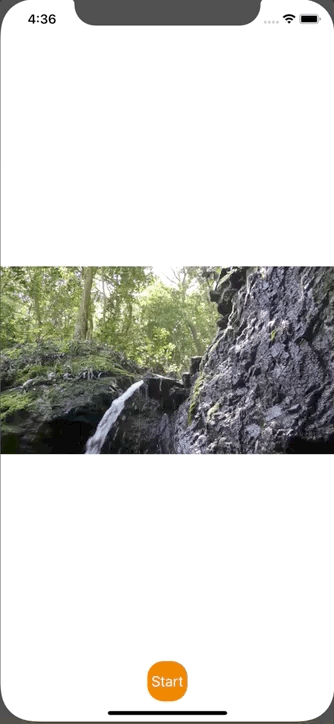

+++
title =  "Swiftで動画の終了を検知する"
url = "2020-02-22"
date = "2020-02-22"
description = "Swiftで動画の終了を検知する"
tags = ["Swift"]
categories = ["Swift"]
archives = "2020/02"
+++

<br>

Swiftで動画の終了を検知するサンプルです。
動画はこちらのサイトからお借りしました。

[Hybrid Creative Movies SAKURA](https://www.home-movie.biz/free_movie.html)

こちらのサイトを参考にさせて頂きました。

[動画の再生](https://docs.fabo.io/swift/avfoundation/006_avfoundation.html)
[How to detect when AVPlayer video ends playing?](https://stackoverflow.com/questions/29386531/how-to-detect-when-avplayer-video-ends-playing)



<!-- Google Ads -->


<!-- Amazon Ads -->


<!--more-->

**ViewController.swift**

```swift
import UIKit
import AVFoundation

class ViewController: UIViewController {
    var videoPlayer: AVPlayer!
    
    override func viewDidLoad() {
        super.viewDidLoad()
        
        // Create AVPlayerItem
        guard let path = Bundle.main.path(forResource: "movie", ofType: "mp4") else {
            fatalError("Movie file can not find.")
        }
        let fileURL = URL(fileURLWithPath: path)
        let avAsset = AVURLAsset(url: fileURL)
        let playerItem: AVPlayerItem = AVPlayerItem(asset: avAsset)
        
        // Create AVPlayer
        videoPlayer = AVPlayer(playerItem: playerItem)
        
        // Add AVPlayer
        let layer = AVPlayerLayer()
        layer.videoGravity = AVLayerVideoGravity.resizeAspect
        layer.player = videoPlayer
        layer.frame = view.bounds
        view.layer.addSublayer(layer)
        
        // Observe
        NotificationCenter.default.addObserver(self, selector: #selector(playerDidFinishPlaying), name: .AVPlayerItemDidPlayToEndTime, object: playerItem)
        
        // Create Movie Start Button
        let startButton = UIButton(frame: CGRect(x: 0, y: 0, width: 50, height: 50))
        startButton.layer.position = CGPoint(x: self.view.bounds.midX, y: self.view.bounds.maxY - 50)
        startButton.layer.masksToBounds = true
        startButton.layer.cornerRadius = 20.0
        startButton.backgroundColor = UIColor.orange
        startButton.setTitle("Start", for: UIControl.State.normal)
        startButton.addTarget(self, action: #selector(onStartButtonTapped), for: UIControl.Event.touchUpInside)
        view.addSubview(startButton)
    }
    
    // Start Button Tapped
    @objc func onStartButtonTapped(){
        videoPlayer.seek(to: CMTimeMakeWithSeconds(0, preferredTimescale: Int32(NSEC_PER_SEC)))
        videoPlayer.play()
    }
    
    // Movie Did Finish
    @objc func playerDidFinishPlaying() {
        print("MovieFinish!!")
        let actionAlert = UIAlertController(title: "MovieFinish!!", message: "MovieFinish", preferredStyle: UIAlertController.Style.alert)
        let alertAction = UIAlertAction(title: "Cancel", style: UIAlertAction.Style.cancel, handler: nil)
        actionAlert.addAction(alertAction)
        present(actionAlert, animated: true, completion: nil)
    }
    
    deinit {
        NotificationCenter.default.removeObserver(self)
    }
}
```

