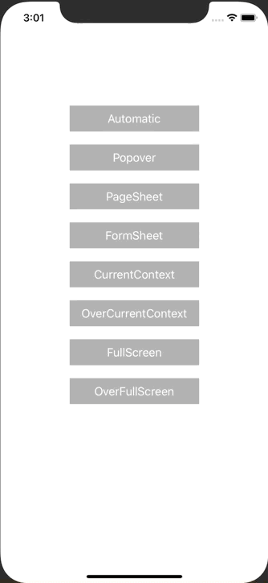

+++
title =  "iOS13のModalPresentationStyleを全部試してみた"
url = "2020-02-23"
date = "2020-02-23"
description = "iOS13のModalPresentationStyleを全部試してみた"
tags = ["Swift"]
categories = ["Swift"]
archives = "2020/02"
+++

<br>

iOS13のModalPresentationStyleを全部試してみました。
PopPage モーダルのことを弊社弊部所では「おしゃれモーダル」と呼んでいます。



<!-- Google Ads -->


<!-- Amazon Ads -->


<!--more-->

**ViewController.swift**

```swift
import UIKit

class ViewController: UIViewController {
    
    override func viewDidLoad() {
        super.viewDidLoad()
        
        let width = view.bounds.size.width
        
        let automaticButton = createButton(title: "Automatic")
        automaticButton.center = CGPoint(x: width / 2, y: 180)
        automaticButton.addTarget(self, action: #selector(automatic), for: .touchUpInside)
        view.addSubview(automaticButton)
        
        let popoverButton = createButton(title: "Popover")
        popoverButton.center = CGPoint(x: width / 2, y: 240)
        popoverButton.addTarget(self, action: #selector(popover), for: .touchUpInside)
        view.addSubview(popoverButton)
        
        let pageSheetButton = createButton(title: "PageSheet")
        pageSheetButton.center = CGPoint(x: width / 2, y: 300)
        pageSheetButton.addTarget(self, action: #selector(pageSheet), for: .touchUpInside)
        view.addSubview(pageSheetButton)
        
        let formSheetButton = createButton(title: "FormSheet")
        formSheetButton.center = CGPoint(x: width / 2, y: 360)
        formSheetButton.addTarget(self, action: #selector(formSheet), for: .touchUpInside)
        view.addSubview(formSheetButton)
        
        let currentContextButton = createButton(title: "CurrentContext")
        currentContextButton.center = CGPoint(x: width / 2, y: 420)
        currentContextButton.addTarget(self, action: #selector(currentContext), for: .touchUpInside)
        view.addSubview(currentContextButton)
        
        let overCurrentContextButton = createButton(title: "OverCurrentContext")
        overCurrentContextButton.center = CGPoint(x: width / 2, y: 480)
        overCurrentContextButton.addTarget(self, action: #selector(overCurrentContext), for: .touchUpInside)
        view.addSubview(overCurrentContextButton)
        
        let fullScreenButton = createButton(title: "FullScreen")
        fullScreenButton.center = CGPoint(x: width / 2, y: 540)
        fullScreenButton.addTarget(self, action: #selector(fullScreen), for: .touchUpInside)
        view.addSubview(fullScreenButton)
        
        let overFullScreenButton = createButton(title: "OverFullScreen")
        overFullScreenButton.center = CGPoint(x: width / 2, y: 600)
        overFullScreenButton.addTarget(self, action: #selector(overFullScreen), for: .touchUpInside)
        view.addSubview(overFullScreenButton)
    }
    
    func createButton(title: String) -> UIButton{
        let button = UIButton()
        button.setTitle(title, for: .normal)
        button.frame.size = CGSize(width: 200, height: 40)
        button.backgroundColor = .lightGray
        return button
    }
    
    func createViewController(text: String) -> ViewController {
        let viewController = ViewController()
        viewController.view.backgroundColor = .white
        
        let label = UILabel()
        label.text = text
        label.textAlignment = .center
        label.frame = CGRect(x: 0, y: 40, width: view.bounds.width, height: 60)
        viewController.view.addSubview(label)
        
        let close = UIButton()
        close.setTitle("Close", for: .normal)
        close.frame = CGRect(x: 20, y: 40, width: 60, height: 60)
        close.addTarget(self, action: #selector(doClose), for: .touchUpInside)
        close.backgroundColor = .lightGray
        viewController.view.addSubview(close)
        
        return viewController
    }
    
    @objc func doClose() {
        dismiss(animated: true, completion: nil)
    }
    
    @objc func automatic() {
        let viewController = createViewController(text: "Automatic")
        viewController.modalPresentationStyle = .automatic
        present(viewController, animated: true)
    }
    
    @objc func popover() {
        let viewController = createViewController(text: "Popover")
        viewController.modalPresentationStyle = .popover
        present(viewController, animated: true)
    }
    
    @objc func pageSheet() {
        let viewController = createViewController(text: "PageSheet")
        viewController.modalPresentationStyle = .pageSheet
        present(viewController, animated: true)
    }
    
    @objc func formSheet() {
        let viewController = createViewController(text: "FormSheet")
        viewController.modalPresentationStyle = .formSheet
        present(viewController, animated: true)
    }
    
    @objc func currentContext() {
        let viewController = createViewController(text: "CurrentContext")
        viewController.modalPresentationStyle = .currentContext
        present(viewController, animated: true)
    }
    
    @objc func overCurrentContext() {
        let viewController = createViewController(text: "OverCurrentContext")
        viewController.modalPresentationStyle = .overCurrentContext
        present(viewController, animated: true)
    }
    
    @objc func fullScreen() {
        let viewController = createViewController(text: "FullScreen")
        viewController.modalPresentationStyle = .fullScreen
        present(viewController, animated: true)
    }
    
    @objc func overFullScreen() {
        let viewController = createViewController(text: "OverFullScreen")
        viewController.modalPresentationStyle = .overFullScreen
        present(viewController, animated: true)
    }
}
```

