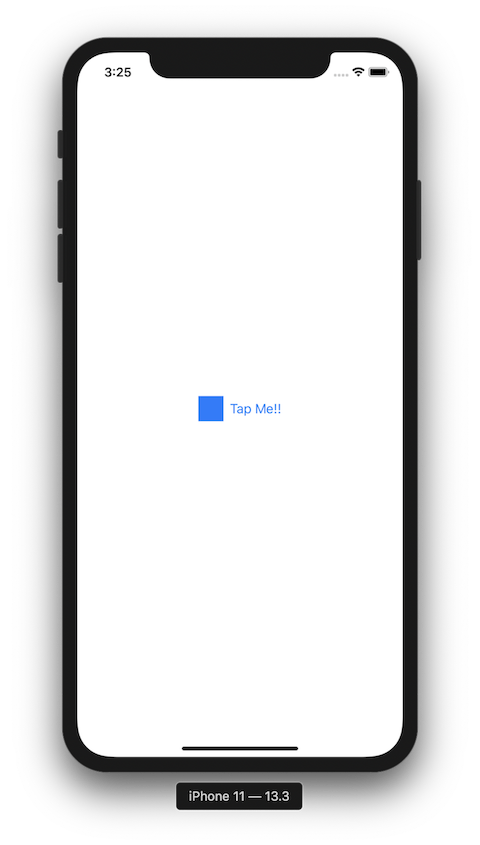

+++
title =  "SwiftUIでButton内の画像の色を変えない"
url = "2020-02-24"
date = "2020-02-24"
description = "SwiftUIでButton内の画像の色を変えない"
tags = ["Swift", "SwiftUI"]
categories = ["Swift"]
archives = "2020/02"
+++

<br>

SwiftUIでButton内の画像の色を変えない方法です。
デフォルトのままだと以下の画像のように色が青く変わってしまいます。



`renderingMode(.original)` と設定することで、元の画像の色が表示されました。


<!-- Google Ads -->


<!-- Amazon Ads -->


<!--more-->

**ContentView.swift**

```swift
import SwiftUI

struct ContentView: View {
    
    var body: some View {
        Button(action: {
            print("Tapped")
        }) {
            Image("icon")
                .resizable()
                .renderingMode(.original)
                .frame(width: 32, height: 32)
            
            Text("Tap Me!!")
                .foregroundColor(Color.black)
        }
    }
}

struct ContentView_Previews: PreviewProvider {
    static var previews: some View {
        ContentView()
    }
}
```

