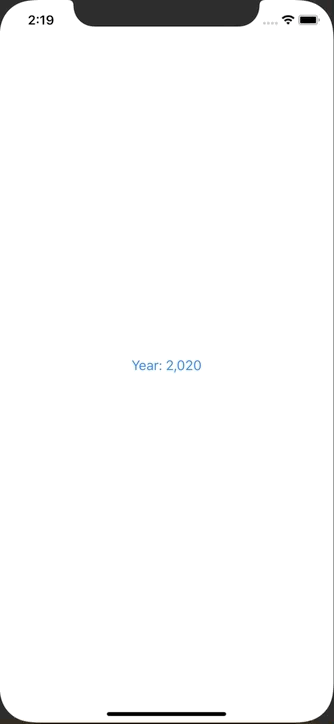

+++
title =  "SwiftUIで下からPickerを出す"
url = "2020-02-26"
date = "2020-02-26"
description = "SwiftUIで下からPickerを出す"
tags = ["Swift", "SwiftUI"]
categories = ["Swift"]
archives = "2020/02"
+++

<br>

SwiftUIで下から Picker を出す方法です。
下からモーダルのように表示させています。



[Importing an image into SwiftUI using UIImagePickerController](https://www.hackingwithswift.com/books/ios-swiftui/importing-an-image-into-swiftui-using-uiimagepickercontroller)

<!-- Google Ads -->


<!-- Amazon Ads -->


<!--more-->

**ContentView.swift**

```swift
import SwiftUI

struct ContentView: View {
    @State private var year = 2020
    @State private var isShowingPicker = false
    
    var body: some View {
        ZStack {
            Button(action: {
                self.isShowingPicker.toggle()
            }) {
                Text("Year: \(self.year)")
                    .padding()
            }
            
            NumberPicker(selection: self.$year, isShowing: self.$isShowingPicker)
                .animation(.linear)
                .offset(y: self.isShowingPicker ? 0 : UIScreen.main.bounds.height)
        }
    }
}

struct NumberPicker: View {
    @Binding var selection: Int
    @Binding var isShowing: Bool
    var body: some View {
        VStack {
            Spacer()
            Button(action: {
                self.isShowing = false
            }) {
                HStack {
                    Spacer()
                    Text("Close")
                        .padding(.horizontal, 16)
                }
            }
            
            Picker(selection: $selection, label: Text("")) {
                ForEach((1900..<2100), id: \.self) {
                    Text("\($0)")
                        .tag($0)
                }
            }
            .frame(width: 200)
            .labelsHidden()
        }
    }
}

struct ContentView_Previews: PreviewProvider {
    static var previews: some View {
        ContentView()
    }
}
```

