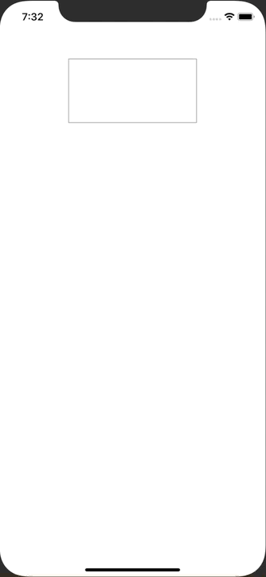

+++
title =  "SwiftUIで複数行の文字列を入力する"
url = "2020-02-27"
date = "2020-02-27"
description = "SwiftUIで複数行の文字列を入力する"
tags = ["Swift", "SwiftUI"]
categories = ["Swift"]
archives = "2020/02"
+++

<br>

SwiftUIで複数行の文字列を入力する方法です。
UIKitのTextViewを使って実現しています。
早く公式でTextView 相当のものが出て欲しいです。



<!-- Google Ads -->


<!-- Amazon Ads -->


<!--more-->

**ContentView.swift**

```swift
import SwiftUI

struct ContentView: View {
    @State var text: String = ""
    
    var body: some View {
        VStack {
            Text(text)
                .padding()
            
            MultilineTextView(text: $text)
                .padding()
                .frame(width: 200, height: 100)
                .border(Color.gray)
            
            Spacer()
        }
    }
}

struct ContentView_Previews: PreviewProvider {
    static var previews: some View {
        ContentView()
    }
}

```


**MultilineTextView.swift**

```swift
import SwiftUI

struct MultilineTextView: UIViewRepresentable {
    @Binding var text: String
    
    final class Coordinator: NSObject, UITextViewDelegate {
        private var textView: MultilineTextView
        
        init(_ textView: MultilineTextView) {
            self.textView = textView
        }
        
        func textView(_ textView: UITextView, shouldChangeTextIn range: NSRange, replacementText text: String) -> Bool {
            return true
        }
        
        func textViewDidChange(_ textView: UITextView) {
            self.textView.text = textView.text
        }
    }
    
    func makeCoordinator() -> Coordinator {
        Coordinator(self)
    }
    
    func makeUIView(context: Context) -> UITextView {
        let textView = UITextView()
        textView.delegate = context.coordinator
        textView.isScrollEnabled = true
        textView.isEditable = true
        textView.isUserInteractionEnabled = true
        return textView
    }
    
    func updateUIView(_ uiView: UITextView, context: Context) {
        uiView.text = text
    }
}

struct MultilineTextView_Previews: PreviewProvider {
    static var previews: some View {
        PreviewWrapper()
    }
    
    struct PreviewWrapper: View {
        @State var text: String = ""
        var body: some View {
            MultilineTextView(text: $text)
        }
    }
}
```

