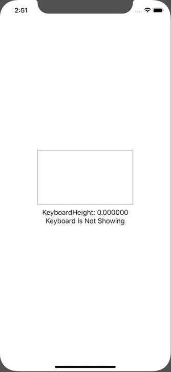

+++
title =  "SwiftUIでキーボードをボタンで隠す"
url = "2020-02-29"
date = "2020-02-29"
description = "SwiftUIでキーボードをボタンで隠す"
tags = ["Swift", "SwiftUI"]
categories = ["Swift"]
archives = "2020/02"
+++

<br>

SwiftUIでキーボードをボタンで隠す方法です。
UIApplicationを拡張して実現しています。



[SwiftUIでキーボードを下げる（非表示にする）方法](https://qiita.com/Riscait/items/8e76182d8b4c2def0953)

<!-- Google Ads -->


<!-- Amazon Ads -->


<!--more-->

**ContentView.swift**

```swift
import SwiftUI

struct ContentView: View {
    @State var text: String = ""
    @ObservedObject var keyboard: KeyboardObserver = KeyboardObserver()
    
    var body: some View {
        VStack {
            TextField("Input Your Text", text: $text)
                .padding()
            Text("KeyboardHeight: \(keyboard.height)")
            Text("\(keyboard.isShowing ? "Keyboard Is Showing" : "Keyboard Is Not Showing")")
            Spacer()
        }.onAppear{
            self.keyboard.addObserver()
        }.onDisappear {
            self.keyboard.removeObserver()
        }
    }
}

struct ContentView_Previews: PreviewProvider {
    static var previews: some View {
        ContentView()
    }
}
```


**KeyboardObserver.swift**

```swift
import SwiftUI

class KeyboardObserver: ObservableObject {
    @Published var isShowing = false
    @Published var height: CGFloat = 0
    
    func addObserver() {
        NotificationCenter.default.addObserver(self, selector: #selector(self.keyboardWillShow(_:)), name: UIResponder.keyboardWillShowNotification, object: nil)
        NotificationCenter.default.addObserver(self, selector: #selector(self.keyboardWillHide(_:)), name: UIResponder.keyboardWillHideNotification, object: nil)
    }
    
    func removeObserver() {
        NotificationCenter.default.removeObserver(self,name: UIResponder.keyboardWillShowNotification,object: nil)
        NotificationCenter.default.removeObserver(self,name: UIResponder.keyboardWillHideNotification,object: nil)
    }
    
    @objc func keyboardWillShow(_ notification: Notification) {
        isShowing = true
        guard let userInfo = notification.userInfo as? [String: Any] else {
            return
        }
        guard let keyboardInfo = userInfo[UIResponder.keyboardFrameEndUserInfoKey] as? NSValue else {
            return
        }
        let keyboardSize = keyboardInfo.cgRectValue.size
        height = keyboardSize.height
    }
    
    @objc func keyboardWillHide(_ notification: Notification) {
        isShowing = false
        height = 0
    }
}
```

