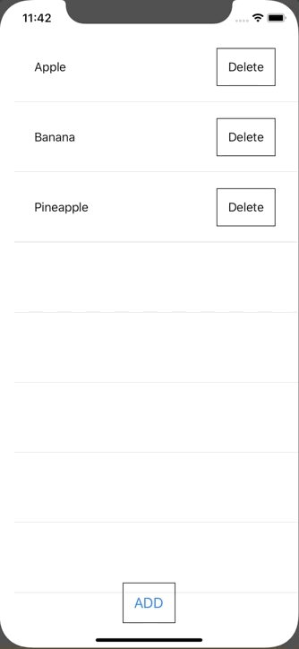

+++
title =  "SwiftUIでListの要素を削除した入り増やしたりする"
url = "2020-03-01"
date = "2020-03-01"
description = "SwiftUIでListの要素を削除した入り増やしたりする"
tags = ["Swift", "SwiftUI"]
categories = ["Swift"]
archives = "2020/03"
+++

<br>

SwiftUIでListの要素を削除した入り増やしたりする方法です。
Closure で渡すのはあまりよくない気がします。
もっと良い方法がありましたら教えてください。



<!-- Google Ads -->


<!-- Amazon Ads -->


<!--more-->

**ContentView.swift**

```swift
import SwiftUI

struct ContentView: View {
    @State var fruits: [Fruit] = [Fruit(name: "Apple"), Fruit(name: "Banana"), Fruit(name: "Grape")]
    
    var body: some View {
        ZStack {
            List(fruits) { fruit in
                Row(fruit: fruit) { id in
                    self.removeFruit(id: id)
                }
            }
            
            VStack {
                Spacer()
                Button(action: {
                    self.fruits.append(Fruit(name: "New Fruit"))
                }) {
                    Text("Add Fruit")
                        .font(Font.system(size: 20))
                        .padding()
                        .border(Color.gray)
                }
            }
        }
    }
    
    func removeFruit(id: UUID) {
        if let index = fruits.firstIndex(where: { $0.id == id }) {
            fruits.remove(at: index)
        }
    }
}

struct Fruit: Identifiable {
    let id = UUID()
    let name: String
}

struct Row: View {
    let fruit: Fruit
    let closure: (_ id: UUID) -> Void
    var body: some View {
        HStack {
            Text(fruit.name)
                .padding()
            Spacer()
            Button(action: {
                self.closure(self.fruit.id)
            }) {
                Text("Delete")
                    .font(Font.system(size: 20))
                    .padding()
                    .border(Color.gray)
            }
        }
    }
}

struct ContentView_Previews: PreviewProvider {
    static var previews: some View {
        ContentView()
    }
}
```

