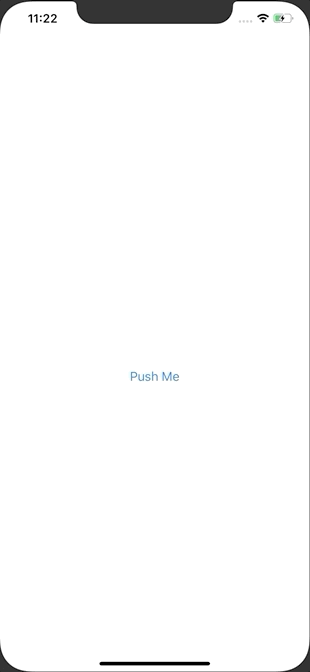

+++
title =  "SwiftUIでWebViewを表示する"
url = "2020-03-27"
date = "2020-03-27"
description = "SwiftUIでWebViewを表示する"
tags = ["Swift", "SwiftUI"]
categories = ["Swift"]
archives = "2020/03"
+++

<br>

SwiftUIでWebViewを表示する方法です。
UIViewRepresentable を使わなくても良い WebView が早く出て欲しいです。



<!-- Google Ads -->


<!-- Amazon Ads -->


<!--more-->

**ContentView.swift**

```swift
import SwiftUI

struct ContentView: View {
    var body: some View {
        NavigationView {
            NavigationLink(destination: SecondView(urlString: "https://www.google.com/")) {
                Text("Push Me")
            }
        }
    }
}

struct ContentView_Previews: PreviewProvider {
    static var previews: some View {
        ContentView()
    }
}
```


**MyWebView.swift**

```swift
import SwiftUI
import WebKit

struct MyWebView: UIViewRepresentable {
    let urlString: String
    
    func makeUIView(context: Context) -> WKWebView {
        return WKWebView()
    }
    
    func updateUIView(_ uiView: WKWebView, context: Context) {
        guard let url = URL(string: urlString) else {
            return
        }
        uiView.load(URLRequest(url: url))
    }
}

struct MyWebView_Previews: PreviewProvider {
    static var previews: some View {
        MyWebView(urlString: "https://www.google.com/")
    }
}
```


**SecondView.swift**

```swift
import SwiftUI

struct SecondView: View {
    let urlString: String
    
    var body: some View {
        MyWebView(urlString: urlString)
            .navigationBarTitle(Text(urlString), displayMode: .inline)
    }
}

struct SecondView_Previews: PreviewProvider {
    static var previews: some View {
        SecondView(urlString: "https://www.google.com/")
    }
}
```

