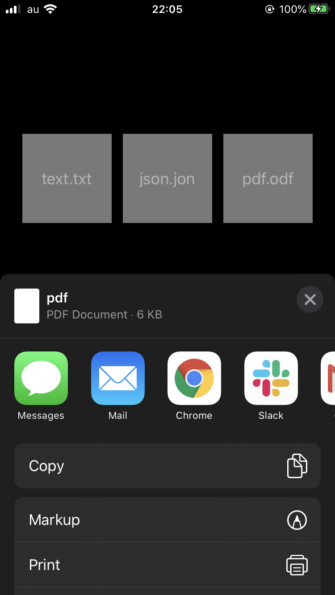

+++
title =  "UIActivityViewControllerでText, JSON, PDFを共有する"
url = "2020-04-02"
date = "2020-04-02"
description = "UIActivityViewControllerでText, JSON, PDFを共有する"
tags = ["iOS", "Swift", "UIKit"]
categories = ["Swift"]
archives = "2020/04"
+++

<br>
UIActivityViewControllerでText, JSON, PDFを共有する方法です。
簡単にファイルが共有できて実装が簡単なので重宝しています。
画像、PDFなどは Data を渡しても認識しますが、JSON などは Data を渡しても認識しないので、ファイルパスを指定しています。



<!-- Google Ads -->


<!-- Amazon Ads -->


<!--more-->

**ViewController.swift**

```swift
import UIKit

class ViewController: UIViewController {
    
    struct HelloWorld: Codable {
        let text: String
    }
    
    override func viewDidLoad() {
        super.viewDidLoad()
        
        let width = view.bounds.width
        let height = view.bounds.height
        
        let textFile = UIButton()
        textFile.frame.size = CGSize(width: 100, height: 100)
        textFile.center = CGPoint(x: width * 0.2, y: height * 0.3)
        textFile.backgroundColor = .lightGray
        textFile.addTarget(self, action: #selector(exportTextFile), for: .touchUpInside)
        textFile.setTitle("text.txt", for: .normal)
        view.addSubview(textFile)
        
        let jsonFile = UIButton()
        jsonFile.frame.size = CGSize(width: 100, height: 100)
        jsonFile.center = CGPoint(x: width * 0.5, y: height * 0.3)
        jsonFile.backgroundColor = .lightGray
        jsonFile.addTarget(self, action: #selector(exportJSONFile), for: .touchUpInside)
        jsonFile.setTitle("json.jon", for: .normal)
        view.addSubview(jsonFile)
        
        let pdfFile = UIButton()
        pdfFile.frame.size = CGSize(width: 100, height: 100)
        pdfFile.center = CGPoint(x: width * 0.8, y: height * 0.3)
        pdfFile.backgroundColor = .lightGray
        pdfFile.addTarget(self, action: #selector(exportPDFFile), for: .touchUpInside)
        pdfFile.setTitle("pdf.odf", for: .normal)
        view.addSubview(pdfFile)
    }
    
    @objc func exportTextFile() {
        let fileName = "text.txt"
        let message = "Hello World"
        
        let dir = FileManager.default.urls( for: .documentDirectory, in: .userDomainMask ).first!
        let filePath = dir.appendingPathComponent( fileName )
        try! message.write( to: filePath, atomically: false, encoding: String.Encoding.utf8 )
        
        sendFile(fileURL: filePath)
    }
    
    @objc func exportJSONFile() {
        let fileName = "json.json"
        let helloWorld = HelloWorld(text: "Hello World")
        
        let data = try! JSONEncoder().encode(helloWorld)
        let text = String(data: data, encoding: .utf8)!
        let dir = FileManager.default.urls( for: .documentDirectory, in: .userDomainMask ).first!
        let filePath = dir.appendingPathComponent( fileName )
        try! text.write( to: filePath, atomically: false, encoding: String.Encoding.utf8 )
        
        sendFile(fileURL: filePath)
    }
    
    
    @objc func exportPDFFile() {
        let fileName = "pdf.pdf"
        
        let pdfMetaData = [
            kCGPDFContextCreator: "@takoikatakotako",
            kCGPDFContextAuthor: "swiswiswift.com"
        ]
        let format = UIGraphicsPDFRendererFormat()
        format.documentInfo = pdfMetaData as [String: Any]
        
        // A4 Aspect
        let pdfWidth: CGFloat = 2100
        let pdfHeight: CGFloat = 2900
        
        let pageRect = CGRect(x: 0, y: 0, width: pdfWidth, height: pdfHeight)
        let renderer = UIGraphicsPDFRenderer(bounds: pageRect, format: format)
        
        let data = renderer.pdfData { (context) in
            context.beginPage()
            
            // WriteText
            let text = "Hello World"
            let attributes = [
                NSAttributedString.Key.font: UIFont.boldSystemFont(ofSize: 72)
            ]
            text.draw(at: CGPoint(x: 0, y: 0), withAttributes: attributes)
        }
        let dir = FileManager.default.urls( for: .documentDirectory, in: .userDomainMask ).first!
        let filePath = dir.appendingPathComponent( fileName )
        try! data.write(to: filePath, options: .atomic)
        
        sendFile(fileURL: filePath)
    }
    
    func sendFile(fileURL: URL) {
        let activityViewController = UIActivityViewController(activityItems: [fileURL], applicationActivities: nil)
        present(activityViewController, animated: true, completion: nil)
    }
}
```

