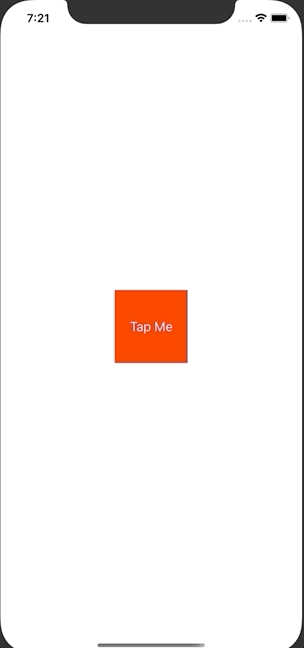

+++
title =  "SwiftでPDFを作成する"
url = "2020-04-03"
date = "2020-04-03"
description = "SwiftでPDFを作成する"
tags = ["Swift"]
categories = ["Swift"]
archives = "2020/04"
+++

<br>

Swift で PDF を作成する方法です。
PDFKit で簡単に PDF を作ることができました、素敵ですね。



<!-- Google Ads -->


<!-- Amazon Ads -->


参考: [Creating a PDF in Swift with PDFKit](https://www.raywenderlich.com/4023941-creating-a-pdf-in-swift-with-pdfkit)

<!--more-->

**PDFViewerViewController.swift**

```swift
import UIKit
import PDFKit

class PDFViewerViewController: UIViewController {
    
    override func viewDidLoad() {
        super.viewDidLoad()
        
        let pdfData = createPDFData()
        let pdfDocument = PDFDocument(data: pdfData)
        let pdfView = PDFView()
        pdfView.frame = view.bounds
        pdfView.document = pdfDocument
        view.addSubview(pdfView)
    }
    
    private func createPDFData() -> Data {
        let pdfMetaData = [
            kCGPDFContextCreator: "@takoikatakotako",
            kCGPDFContextAuthor: "swiswiswift.com"
        ]
        let format = UIGraphicsPDFRendererFormat()
        format.documentInfo = pdfMetaData as [String: Any]
        
        // A4 Aspect
        let pdfWidth: CGFloat = 2100
        let pdfHeight: CGFloat = 2900
        
        let pageRect = CGRect(x: 0, y: 0, width: pdfWidth, height: pdfHeight)
        let renderer = UIGraphicsPDFRenderer(bounds: pageRect, format: format)
        
        let data = renderer.pdfData { (context) in
            for i in 0..<5 {
                context.beginPage()
                
                // WriteText
                let text = "Page \(i)"
                let attributes = [
                    NSAttributedString.Key.font: UIFont.boldSystemFont(ofSize: 72)
                ]
                text.draw(at: CGPoint(x: 0, y: 0), withAttributes: attributes)
                
                // WritePath
                for _ in 0...10 {
                    let initialX = CGFloat.random(in: 0 ... pdfWidth)
                    let initialY = CGFloat.random(in: 0 ... pdfHeight)
                    let finalX = CGFloat.random(in: 0 ... pdfWidth)
                    let finalY = CGFloat.random(in: 0 ... pdfHeight)
                    
                    let linePath = UIBezierPath()
                    linePath.move(to: CGPoint(x: initialX, y: initialY))
                    linePath.addLine(to: CGPoint(x: finalX, y: finalY))
                    
                    let layer = CAShapeLayer()
                    layer.path = linePath.cgPath
                    layer.fillColor = UIColor.black.cgColor
                    layer.strokeColor = UIColor.black.cgColor
                    layer.lineWidth = 4
                    layer.render(in: context.cgContext)
                }
            }
        }
        return data
    }
}

```


**ViewController.swift**

```swift
import UIKit

class ViewController: UIViewController {
    
    override func viewDidLoad() {
        super.viewDidLoad()
        
        let button = UIButton()
        button.frame.size = CGSize(width: 100, height: 100)
        button.center = view.center
        button.backgroundColor = .red
        button.addTarget(self, action: #selector(tapped), for: .touchUpInside)
        button.setTitle("Tap Me", for: .normal)
        view.addSubview(button)
    }
    
    @objc func tapped() {
        let pdfViewerViewController = PDFViewerViewController()
        let navigationViewController = UINavigationController(rootViewController: pdfViewerViewController)
        present(navigationViewController, animated: true, completion: nil)
    }
}
```

