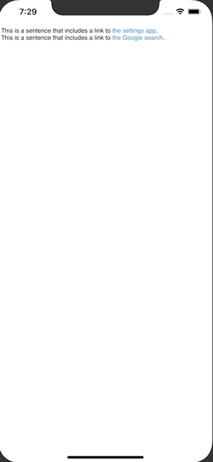

+++
title =  "SwiftUI で文字列中にタップ可能なリンクを追加する"
url = "2020-05-03"
date = "2020-05-03"
description = "SwiftUI で文字列中にタップ可能なリンクを追加する"
tags = ["Swift", "SwiftUI"]
categories = ["Swift", "SwiftUI"]
archives = "2020/05"
+++

<br>

SwiftUI で文字列中にタップ可能なリンクを追加するを作成する方法です。
`UIViewRepresentable` と `UITextView` を使って実現しました。

Reference: [UITextViewにタップ可能なリンクを挿入する](https://qiita.com/shtnkgm/items/3c8b6b794219fbf087ba)



<!-- Google Ads -->


<!-- Amazon Ads -->


<!--more-->

**ContentView.swift**

```swift
import SwiftUI

struct ContentView: View {
    
    var body: some View {
        AttributedText(getAttributeString())
    }

    func getAttributeString() -> NSAttributedString {
        let baseString = """
        This is a sentence that includes a link to the settings app.
        This is a sentence that includes a link to the Google search.
        """

        let attributedString = NSMutableAttributedString(string: baseString)
        attributedString.addAttribute(.link,
                                      value: UIApplication.openSettingsURLString,
                                      range: NSString(string: baseString).range(of: "the settings app"))
        attributedString.addAttribute(.link,
                                      value: "https://www.google.co.jp/",
                                      range: NSString(string: baseString).range(of: "the Google search"))
        return attributedString
    }
}

struct AttributedText: UIViewRepresentable {
    var attributedText: NSAttributedString

    init(_ attributedText: NSAttributedString) {
        self.attributedText = attributedText
    }

    func makeUIView(context: Context) -> UITextView {
        let textView = UITextView()
        textView.isEditable = false
        textView.isSelectable = true
        return textView
    }

    func updateUIView(_ textView: UITextView, context: Context) {
        textView.attributedText = attributedText
    }
}

struct ContentView_Previews: PreviewProvider {
    static var previews: some View {
        ContentView()
    }
}
```

