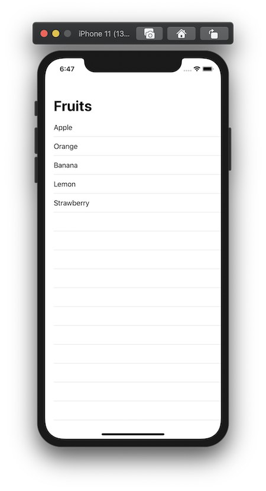
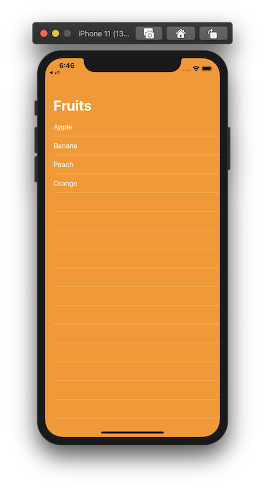

+++
title =  "SwiftUIでNavigationViewのタイトルやテーブルビューの背景を変える"
url = "2020-05-04"
date = "2020-05-04"
description = "SwiftUIでNavigationViewのタイトルやテーブルビューの背景を変える"
tags = ["Swift", "SwiftUI"]
categories = ["Swift", "SwiftUI"]
archives = "2020/05"
+++

<br>

SwiftUIでNavigationViewのタイトルやテーブルビューの背景を変える方法です。
`TableView` と `UITextView` の `appearance` を変更しました。





<!-- Google Ads -->


<!-- Amazon Ads -->


<!--more-->

**CanNotChangeBackgroundView.swift**

```swift
struct CanNotChangeBackgroundView: View {
    var body: some View {
        NavigationView {
            List {
                Text("Apple")
                Text("Orange")
                Text("Banana")
                Text("Lemon")
                Text("Strawberry")
            }
            .background(Color.orange)
            .navigationBarTitle("Fruits")
        }
    }
}
```


**ContentView.swift**

```swift
import SwiftUI

struct ContentView: View {
    init() {
        // Large Title Text Color
        UINavigationBar.appearance().largeTitleTextAttributes = [NSAttributedString.Key.foregroundColor:UIColor.white]
        UINavigationBar.appearance().titleTextAttributes = [NSAttributedString.Key.foregroundColor:UIColor.white]
        UITableView.appearance().backgroundColor = UIColor.clear
        UITableView.appearance().separatorStyle = .singleLine
        UITableView.appearance().separatorColor = UIColor.white.withAlphaComponent(0.6)
        UITableViewCell.appearance().backgroundColor = .clear
    }

    var body: some View {
        NavigationView {
            ZStack {
                // Background Color
                Color.orange.edgesIgnoringSafeArea(.all)
                List {
                    Text("Apple")
                        .foregroundColor(Color.white)
                    Text("Banana")
                        .foregroundColor(Color.white)
                    Text("Peach")
                        .foregroundColor(Color.white)
                    Text("Orange")
                        .foregroundColor(Color.white)
                }
                .background(Color.orange)
                .navigationBarTitle("Fruits")
            }
        }
    }
}

struct ContentView_Previews: PreviewProvider {
    static var previews: some View {
        ContentView()
    }
}

```

