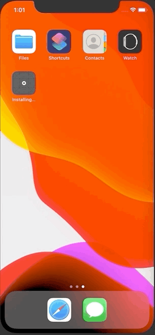

+++
title =  "SwiftUIでアプリ起動時に画面を遷移させる"
url = "2020-05-12"
date = "2020-05-12"
description = "SwiftUIでアプリ起動時に画面を遷移させる"
tags = ["Swift", "SwiftUI"]
categories = ["Swift", "SwiftUI"]
archives = "2020/05"
+++

<br>

SwiftUIでアプリ起動時に画面を遷移させる方法です。
登録の導線で途中離脱したらその途中から再開させるようなUXを実現させようとしました。
NavigationLink の isActive を使って遷移していますが、遅延時間を設定しないとアプリの挙動がおかしくなってしまうので気をつけてください。



<!-- Google Ads -->


<!-- Amazon Ads -->


<!--more-->

**CompleteView.swift**

```swift
import SwiftUI

struct CompleteView: View {
    @State var password: String = ""
    var body: some View {
        Text("Complete")
            .padding()
            .navigationBarTitle("Complete")
    }
}

struct CompleteView_Previews: PreviewProvider {
    static var previews: some View {
        CompleteView()
    }
}
```


**ContentView.swift**

```swift
import SwiftUI

struct ContentView: View {
    var body: some View {
        NavigationView {
            EmailView()
        }
    }
}

struct ContentView_Previews: PreviewProvider {
    static var previews: some View {
        ContentView()
    }
}

```


**EmailView.swift**

```swift
import SwiftUI

class EmailViewModel: ObservableObject {
    @Published var email = "" {
        didSet {
            UserDefaults.standard.set(email, forKey: "email")
        }
    }
    @Published var isActive: Bool = false
    private var isFirstAppear = true
    
    func onAppear() {
        guard isFirstAppear else {
            return
        }
        isFirstAppear = false
        
        guard let email = UserDefaults.standard.string(forKey: "email") else {
            return
        }
        self.email = email
        
        // Validation
        if self.email.count > 8 {
            DispatchQueue.main.asyncAfter(deadline: .now() + 0.5) {
                self.isActive = true
            }
        }
    }
}

struct EmailView: View {
    @ObservedObject var emailViewModel = EmailViewModel()
    var body: some View {
        VStack(spacing: 16) {
            TextField("email", text: $emailViewModel.email)
                .textFieldStyle(RoundedBorderTextFieldStyle())
            
            NavigationLink(destination: PasswordView(), isActive: $emailViewModel.isActive) {
                ButtonView(title: "次へ")
            }
            
            Spacer()
        }.onAppear{
            self.emailViewModel.onAppear()
        }
        .padding()
        .navigationBarTitle("Email")
    }
}

struct EmailView_Previews: PreviewProvider {
    static var previews: some View {
        EmailView()
    }
}
```


**PasswordView.swift**

```swift
import SwiftUI

class PasswordViewModel: ObservableObject {
    @Published var password = "" {
        didSet {
            UserDefaults.standard.set(password, forKey: "password")
        }
    }
    
    @Published var isActive: Bool = false
    private var isFirstAppear = true
    
    func onAppear() {
        guard isFirstAppear else {
            return
        }
        isFirstAppear = false
        
        guard let password = UserDefaults.standard.string(forKey: "password") else {
            return
        }
        self.password = password
        // Validation
        if self.password.count > 8 {
            DispatchQueue.main.asyncAfter(deadline: .now() + 1.0) {
                self.isActive = true
            }
        }
    }
}

struct PasswordView: View {
    @ObservedObject var passwordViewModel = PasswordViewModel()
    var body: some View {
        VStack(spacing: 16) {
            TextField("password", text: $passwordViewModel.password)
                .textFieldStyle(RoundedBorderTextFieldStyle())
            
            NavigationLink(destination: CompleteView(), isActive: $passwordViewModel.isActive) {
                ButtonView(title: "Next")
            }
            
            Spacer()
        }.onAppear{
            self.passwordViewModel.onAppear()
        }
        .padding()
        .navigationBarTitle("Password")
    }
}

struct PasswordView_Previews: PreviewProvider {
    static var previews: some View {
        PasswordView()
    }
}
```

