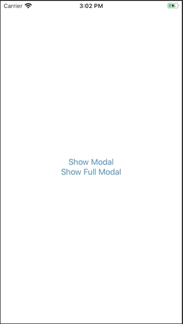

+++
title =  "SwiftUIでモーダルからフルモーダルを表示する"
url = "2020-05-13"
date = "2020-05-13"
description = "SwiftUIでモーダルからフルモーダルを表示する"
tags = ["Swift", "SwiftUI"]
categories = ["Swift", "SwiftUI"]
archives = "2020/05"
+++

<br>

SwiftUIでモーダルからフルモーダルを表示する方法です。
以下の記事の改良版？です。

[SwiftUIでフルスクリーンモーダルを表示する](/2020-05-05/)



<!-- Google Ads -->


<!-- Amazon Ads -->


<!--more-->

**ContentView.swift**

```swift
import SwiftUI
import UIKit

struct ContentView: View {
    @Environment(\.viewController) private var viewControllerHolder: ViewControllerHolder
    @State private var isPresented = false
    
    private var viewController: UIViewController? {
        self.viewControllerHolder.value
    }
    
    var body: some View {
        VStack {
            Button(action: {
                self.isPresented = true
            }) {
                Text("Show Modal")
            }
            .sheet(isPresented: $isPresented) {
                ModalView()
            }
            
            Button(action: {
                self.viewController?.present(
                    presentationStyle: UIModalPresentationStyle.overCurrentContext,
                    transitionStyle: UIModalTransitionStyle.crossDissolve,
                    animated: true) {
                        FullModalView()
                }
            }) {
                Text("Show Full Modal")
            }
        }
    }
}

struct ModalView: View {
    @Environment(\.viewController) private var viewControllerHolder: ViewControllerHolder
    
    private var viewController: UIViewController? {
        self.viewControllerHolder.value
    }
    
    var body: some View {
        Button(action: {
            self.viewController?.present(
                presentationStyle: UIModalPresentationStyle.fullScreen,
                transitionStyle: UIModalTransitionStyle.crossDissolve,
                animated: true) {
                    FullModalView()
            }
        }) {
            Text("Show Full Modal")
        }
    }
}


struct FullModalView: View {
    @Environment(\.viewController) private var viewControllerHolder: ViewControllerHolder
    private var viewController: UIViewController? {
        self.viewControllerHolder.value
    }
    
    var body: some View {
        Button(action: {
            self.viewController?.dismiss(animated: true, completion: nil)
        }) {
            Group {
                VStack {
                    Text("Modal")
                }
                .frame(width: 200, height: 200, alignment: .center)
                .background(Color.white)
            }
            .onAppear() {
                DispatchQueue.main.asyncAfter(deadline: .now() + 2.0) {
                    self.viewController?.dismiss(animated: true, completion: nil)
                }
            }
            .frame(minWidth: 0, maxWidth: .infinity, minHeight: 0, maxHeight: .infinity)
            .background(Color.gray.opacity(0.5))
            .edgesIgnoringSafeArea(.all)
        }
    }
}

struct ViewControllerHolder {
    weak var value: UIViewController?
    init(_ value: UIViewController?) {
        self.value = value
    }
}

struct ViewControllerKey: EnvironmentKey {
    static var defaultValue: ViewControllerHolder {
        guard var visibleViewController = UIApplication.shared.windows.first?.rootViewController else {
            return ViewControllerHolder(nil)
        }
        while let vc = visibleViewController.presentedViewController {
            visibleViewController = vc
        }
        return ViewControllerHolder(visibleViewController)
    }
}

extension EnvironmentValues {
    var viewController: ViewControllerHolder {
        get { return self[ViewControllerKey.self] }
        set { self[ViewControllerKey.self] = newValue }
    }
}

extension UIViewController {
    func present<Content: View>(
        presentationStyle: UIModalPresentationStyle = .automatic,
        transitionStyle: UIModalTransitionStyle = .coverVertical,
        animated: Bool = true,
        backgroundColor: UIColor = .clear,
        completion: @escaping () -> Void = {},
        @ViewBuilder builder: () -> Content) {
        let toPresent = UIHostingController(rootView: AnyView(EmptyView()))
        toPresent.rootView = AnyView(
            builder()
                .environment(\.viewController, ViewControllerHolder(toPresent))
        )
        toPresent.view.backgroundColor = backgroundColor
        toPresent.modalPresentationStyle = presentationStyle
        toPresent.modalTransitionStyle = transitionStyle
        self.present(toPresent, animated: animated, completion: completion)
    }
}

struct ContentView_Previews: PreviewProvider {
    static var previews: some View {
        ContentView()
    }
}
```

