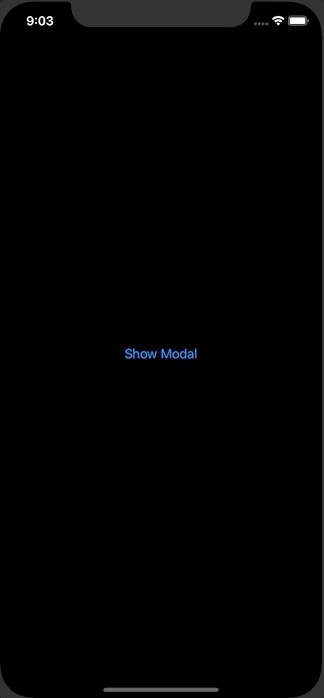

+++
title =  "SwiftUIで閉じることができないモーダルを表示する"
url = "2020-06-01"
date = "2020-06-01"
description = "SwiftUIで閉じることができないモーダルを表示する"
tags = ["Swift", "SwiftUI"]
categories = ["Swift", "SwiftUI"]
archives = "2020/06"
+++

<br>

SwiftUIで閉じることができないモーダルを表示する方法です。
以下の記事の応用です、UIKit を使わないでもできるようになって欲しいです。

[SwiftUIでフルスクリーンモーダルを表示する](/2020-05-05/)



<!-- Google Ads -->


<!-- Amazon Ads -->


<!--more-->

**ContentView.swift**

```swift
import SwiftUI
import UIKit

struct ContentView: View {
    @Environment(\.viewController) private var viewControllerHolder: ViewControllerHolder
    @State private var isPresented = false
    
    private var viewController: UIViewController? {
        self.viewControllerHolder.value
    }
    
    var body: some View {
        VStack {
            Button(action: {
                self.isPresented = true
            }) {
                Text("Show Modal")
            }
            .sheet(isPresented: $isPresented) {
                ModalView()
            }
        }
    }
}

struct ModalView: View {
    @Environment(\.viewController) private var viewControllerHolder: ViewControllerHolder
    
    private var viewController: UIViewController? {
        self.viewControllerHolder.value
    }
    
    var body: some View {
        NavigationView {
            
            Button(action: {
                self.viewController?.dismiss(animated: true, completion: nil)
            }) {
                Text("Dismiss")
            }
            .onAppear {
                self.viewController?.isModalInPresentation = true
            }
        }
    }
}

struct ViewControllerHolder {
    weak var value: UIViewController?
    init(_ value: UIViewController?) {
        self.value = value
    }
}

struct ViewControllerKey: EnvironmentKey {
    static var defaultValue: ViewControllerHolder {
        guard var visibleViewController = UIApplication.shared.windows.first?.rootViewController else {
            return ViewControllerHolder(nil)
        }
        while let vc = visibleViewController.presentedViewController {
            visibleViewController = vc
        }
        return ViewControllerHolder(visibleViewController)
    }
}

extension EnvironmentValues {
    var viewController: ViewControllerHolder {
        get { return self[ViewControllerKey.self] }
        set { self[ViewControllerKey.self] = newValue }
    }
}

extension UIViewController {
    func present<Content: View>(
        presentationStyle: UIModalPresentationStyle = .automatic,
        transitionStyle: UIModalTransitionStyle = .coverVertical,
        animated: Bool = true,
        backgroundColor: UIColor = .clear,
        completion: @escaping () -> Void = {},
        @ViewBuilder builder: () -> Content) {
        let toPresent = UIHostingController(rootView: AnyView(EmptyView()))
        toPresent.rootView = AnyView(
            builder()
                .environment(\.viewController, ViewControllerHolder(toPresent))
        )
        toPresent.modalPresentationStyle = presentationStyle
        toPresent.modalTransitionStyle = transitionStyle
        self.present(toPresent, animated: animated, completion: completion)
    }
}

struct ContentView_Previews: PreviewProvider {
    static var previews: some View {
        ContentView()
    }
}
```

