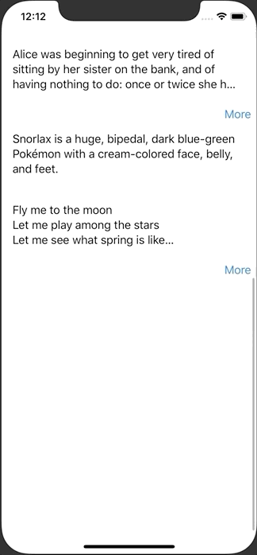

+++
title =  "SwiftUIで続きを読む。。。ボタンがあるViewを実装する"
url = "2020-06-20"
date = "2020-06-20"
description = "SwiftUIで続きを読む。。。ボタンがあるViewを実装する"
tags = ["iOS", "Swift", "SwiftUI"]
categories = ["iOS", "SwiftUI"]
archives = "2020/06"
+++

<br>

SwiftUIで続きを読む。。。ボタンがあるViewを実装する方法です。
背景を透明色にし、そのサイズを PreferenceKey で取得することで実現しています。



<!-- Google Ads -->


<!-- Amazon Ads -->


<!--more-->

**ContentView.swift**

```swift
import SwiftUI

struct ContentView: View {
    private let aliceInWonderland = "Alice was beginning to get very tired of sitting by her sister on the bank, and of having nothing to do: once or twice she had peeped into the book her sister was reading, but it had no pictures or conversations in it, “and what is the use of a book,” thought Alice “without pictures or conversations?”\nSo she was considering in her own mind (as well as she could, for the hot day made her feel very sleepy and stupid), whether the pleasure of making a daisy-chain would be worth the trouble of getting up and picking the daisies, when suddenly a White Rabbit with pink eyes ran close by her.\nThere was nothing so very remarkable in that; nor did Alice think it so very much out of the way to hear the Rabbit say to itself, “Oh dear! Oh dear! I shall be late!” (when she thought it over afterwards, it occurred to her that she ought to have wondered at this, but at the time it all seemed quite natural); but when the Rabbit actually took a watch out of its waistcoat-pocket, and looked at it, and then hurried on, Alice started to her feet, for it flashed across her mind that she had never before seen a rabbit with either a waistcoat-pocket, or a watch to take out of it, and burning with curiosity, she ran across the field after it, and fortunately was just in time to see it pop down a large rabbit-hole under the hedge."
    
    private let snorlax = "Snorlax is a huge, bipedal, dark blue-green Pokémon with a cream-colored face, belly, and feet. "
    
    private let flyMeToTheMoon = """
        Fly me to the moon
        Let me play among the stars
        Let me see what spring is like
        On a-Jupiter and Mars
        In other words, hold my hand
        In other words, baby, kiss me

        Fill my heart with song
        And let me sing for ever more
        You are all I long for
        All I worship and adore
        In other words, please be true
        In other words, I love you

        Fill my heart with song
        Let me sing for ever more
        You are all I long for
        All I worship and adore
        In other words, please be true
        In other words, in other words
        I love … you
        """
    
    
    var body: some View {
        ScrollView {
            VStack {
                ShowMoreView(text: aliceInWonderland)
                ShowMoreView(text: snorlax)
                ShowMoreView(text: flyMeToTheMoon)
            }
        }        
    }
}

struct ContentView_Previews: PreviewProvider {
    static var previews: some View {
        ContentView()
    }
}
```


**ShowMoreView.swift**

```swift
import SwiftUI

struct ShowMoreView: View {
    @State var text: String
    @State private var isFirst = true
    @State private var isFold = false
    @State private var needFoldButton = true
    @State private var textHeight: CGFloat? = nil
    
    var body: some View {
        VStack(alignment: .trailing) {
            HStack {
                Text(text)
                    .frame(height: textHeight)
                    .background(GeometryReader { geometory in
                        Color.clear.preference(key: SizePreference.self, value: geometory.size)
                    })
                    .padding()
                    .onPreferenceChange(SizePreference.self) { textSize in
                        if self.isFirst == true {
                            if textSize.height > 80 {
                                self.textHeight = 80
                                self.isFold = true
                                self.isFirst = false
                            } else {
                                self.needFoldButton = false
                            }
                        }
                }
                Spacer()
            }
            
            if needFoldButton {
                Button(action: {
                    self.isFold.toggle()
                    if self.isFold == true {
                        self.textHeight = 80
                    } else {
                        self.textHeight = nil
                    }
                }) {
                    Text(isFold ? "More" : "Fold")
                }.padding(.trailing, 8)
            }
        }
    }
}

fileprivate struct SizePreference: PreferenceKey {
    static let defaultValue: CGSize = .zero
    static func reduce(value: inout CGSize, nextValue: () -> CGSize) {}
}
```

