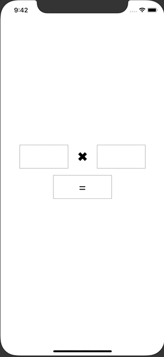

+++
title =  "SwiftUIでUITestを動かす"
url = "2020-06-24"
date = "2020-06-24"
description = "SwiftUIでUITestを動かす"
tags = ["iOS", "Swift", "SwiftUI"]
categories = ["iOS", "SwiftUI"]
archives = "2020/06"
+++

<br>

SwiftUIでUITestを動かす方法です。
UIKit の時と違って sleep を入れないと良い感じに動かなかったです。
State が変わると際レンダリングが走るせいでしょうか？



<!-- Google Ads -->


<!-- Amazon Ads -->


<!--more-->

**ContentView.swift**

```swift
import SwiftUI

struct ContentView: View {
    @State var leftTextFieldValue: String = ""
    @State var rightTextFieldValue: String = ""
    @State var resultValue : String = ""
    
    var buttonDisable: Bool {
        return leftTextFieldValue.isEmpty || rightTextFieldValue.isEmpty
    }
    
    var body: some View {
        VStack {
            HStack {
                TextField("", text: $leftTextFieldValue)
                    .accessibility(identifier: "leftTextField")
                    .frame(height: 60)
                    .padding(.horizontal, 8)
                    .border(Color.gray)
                
                Text("✖︎")
                    .font(Font.system(size: 32))
                    .padding()
                TextField("", text: $rightTextFieldValue)
                    .accessibility(identifier: "rightTextField")
                    .frame(height: 60)
                    .padding(.horizontal, 8)
                    .border(Color.gray)
            }
            Button(action: {
                self.resultButtonOnTap()
            }) {
                Text("=")
                    .font(Font.system(size: 32))
                    .frame(height: 60)
                    .padding(.horizontal, 64)
                    .foregroundColor(Color.black)
            }
            .accessibility(identifier: "resultButton")
            .disabled(buttonDisable)
            .border(Color.gray)
            
            Text(resultValue)
                .accessibility(identifier: "resultLabel")
                .padding()
        }.padding(.horizontal, 48)
    }
    
    private func resultButtonOnTap() {
        guard let leftNumber = Float(leftTextFieldValue), let rightNumber = Float(rightTextFieldValue) else {
            return
        }
        setResultLabel(leftNumber: leftNumber, rightNumber: rightNumber)
    }
    
    private func setResultLabel(leftNumber: Float, rightNumber: Float) {
        resultValue = String(format: "%.1f", leftNumber * rightNumber)
    }
}

struct ContentView_Previews: PreviewProvider {
    static var previews: some View {
        ContentView()
    }
}
```


**SwiSwiSwiftUITests.swift**

```swift
import XCTest

class SwiSwiSwiftUITests: XCTestCase {

    override func setUpWithError() throws {
        // Put setup code here. This method is called before the invocation of each test method in the class.

        // In UI tests it is usually best to stop immediately when a failure occurs.
        continueAfterFailure = false

        // In UI tests it’s important to set the initial state - such as interface orientation - required for your tests before they run. The setUp method is a good place to do this.
    }

    override func tearDownWithError() throws {
        // Put teardown code here. This method is called after the invocation of each test method in the class.
    }

    func testExample() throws {
        // UI tests must launch the application that they test.
        let app = XCUIApplication()
        app.launch()
        
        // 「Get 「=」 Button
        let resultButton = app.buttons["resultButton"]
        
        // 「=」 Button is disable
        XCTAssertFalse(resultButton.isEnabled)
        
        // Get LeftTestField
        let leftTextField = app.textFields["leftTextField"]
        
        // Focus LeftTestField
        leftTextField.tap()
        
        // Input 12
        leftTextField.typeText("1")
        leftTextField.typeText("2")

        // 「=」 Button is disable
        XCTAssertFalse(resultButton.isEnabled)
        
        // Get RightTestField
        let rightTextField = app.textFields["rightTextField"]
        
        // Focus RightTestField
        rightTextField.tap()
        
        // Input 4
        rightTextField.typeText("4")
        
        // 「=」 Button is enabled
        XCTAssertTrue(resultButton.isEnabled)
        
        sleep(1)
        
        // Tap 「=」 Button
        resultButton.tap()
        
        let resultLabel = app.staticTexts["resultLabel"]
        
        // Assert resultLabel.label = 48
        XCTAssertEqual(resultLabel.label, "48.0")
    }
}
```

