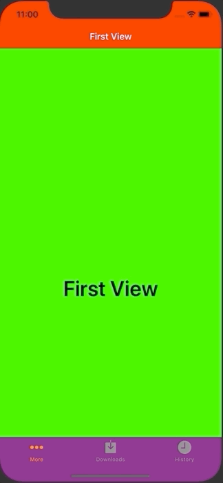

+++
title =  "UINavigationBar, UITabBar の色を変える"
url = "2020-06-26"
date = "2020-06-26"
description = "UINavigationBar, UITabBar の色を変える"
tags = ["iOS", "Swift", "UIKit"]
categories = ["iOS", "Swift"]
archives = "2020/06"
+++

<br>

iOSでUINavigationBar, UITabBar の色を変える方法です。
エヴァンゲリオンをイメージしたカラーリングです。今度のエヴァの映画が楽しみです。



<!-- Google Ads -->


<!-- Amazon Ads -->


<!--more-->

**FirstViewController.swift**

```swift
import UIKit

class FirstViewController: UIViewController {

    override func viewDidLoad() {
        super.viewDidLoad()
        
        title = "First View"
        view.backgroundColor = .green
        
        let firstViewLabel = UILabel()
        firstViewLabel.frame = view.bounds
        firstViewLabel.textAlignment = .center
        firstViewLabel.font = UIFont.boldSystemFont(ofSize: 40)
        firstViewLabel.textColor = .black
        firstViewLabel.text = "First View"
        view.addSubview(firstViewLabel)
    }
}
```


**SceneDelegate.swift**

```swift
import UIKit

class SceneDelegate: UIResponder, UIWindowSceneDelegate {

    var window: UIWindow?


    func scene(_ scene: UIScene, willConnectTo session: UISceneSession, options connectionOptions: UIScene.ConnectionOptions) {
        guard let windowScene = (scene as? UIWindowScene) else { return }
        
        // ナビゲーションバー
        UINavigationBar.appearance().tintColor = UIColor.white
        UINavigationBar.appearance().barTintColor = UIColor.red
        UINavigationBar.appearance().isTranslucent = false
        UINavigationBar.appearance().titleTextAttributes = [NSAttributedString.Key.foregroundColor : UIColor.white]

        // タブバーコントローラー
        UITabBar.appearance().tintColor = UIColor.orange
        UITabBar.appearance().unselectedItemTintColor = UIColor.gray
        UITabBar.appearance().barTintColor = .purple
        UITabBar.appearance().isTranslucent = false

        // ページを格納する配列
        var viewControllers: [UIViewController] = []

        let firstViewController = FirstViewController()
        firstViewController.tabBarItem = UITabBarItem(tabBarSystemItem: UITabBarItem.SystemItem.more, tag: 1)
        let firstNavigationController = UINavigationController(rootViewController: firstViewController)
        viewControllers.append(firstNavigationController)

        let secondViewController = SecondViewController()
        secondViewController.tabBarItem = UITabBarItem(tabBarSystemItem: UITabBarItem.SystemItem.downloads, tag: 2)
        let secondNavigationController = UINavigationController(rootViewController: secondViewController)
        viewControllers.append(secondNavigationController)

        let thirdViewController = ThirdViewController()
        thirdViewController.tabBarItem = UITabBarItem(tabBarSystemItem: UITabBarItem.SystemItem.history, tag: 3)
        let thirdNavigationController = UINavigationController(rootViewController: thirdViewController)
        viewControllers.append(thirdNavigationController)

        let tabBarController = UITabBarController()
        tabBarController.setViewControllers(viewControllers, animated: false)

        window = UIWindow(frame: UIScreen.main.bounds)
        window?.rootViewController = tabBarController
        window?.makeKeyAndVisible()
        window?.windowScene = windowScene
    }

    func sceneDidDisconnect(_ scene: UIScene) {
        // Called as the scene is being released by the system.
        // This occurs shortly after the scene enters the background, or when its session is discarded.
        // Release any resources associated with this scene that can be re-created the next time the scene connects.
        // The scene may re-connect later, as its session was not neccessarily discarded (see `application:didDiscardSceneSessions` instead).
    }

    func sceneDidBecomeActive(_ scene: UIScene) {
        // Called when the scene has moved from an inactive state to an active state.
        // Use this method to restart any tasks that were paused (or not yet started) when the scene was inactive.
    }

    func sceneWillResignActive(_ scene: UIScene) {
        // Called when the scene will move from an active state to an inactive state.
        // This may occur due to temporary interruptions (ex. an incoming phone call).
    }

    func sceneWillEnterForeground(_ scene: UIScene) {
        // Called as the scene transitions from the background to the foreground.
        // Use this method to undo the changes made on entering the background.
    }

    func sceneDidEnterBackground(_ scene: UIScene) {
        // Called as the scene transitions from the foreground to the background.
        // Use this method to save data, release shared resources, and store enough scene-specific state information
        // to restore the scene back to its current state.
    }


}

```


**SecondViewController.swift**

```swift
import UIKit

class SecondViewController: UIViewController {
    
    override func viewDidLoad() {
        super.viewDidLoad()
        
        title = "Second View"
        view.backgroundColor = .green
        
        let firstViewLabel = UILabel()
        firstViewLabel.frame = view.bounds
        firstViewLabel.textAlignment = .center
        firstViewLabel.font = UIFont.boldSystemFont(ofSize: 40)
        firstViewLabel.textColor = .black
        firstViewLabel.text = "Second View"
        view.addSubview(firstViewLabel)
    }
}
```


**ThirdViewController.swift**

```swift
import UIKit

class ThirdViewController: UIViewController {

    override func viewDidLoad() {
        super.viewDidLoad()

        title = "Third View"
        view.backgroundColor = .green
        
        let firstViewLabel = UILabel()
        firstViewLabel.frame = view.bounds
        firstViewLabel.textAlignment = .center
        firstViewLabel.font = UIFont.boldSystemFont(ofSize: 40)
        firstViewLabel.textColor = .black
        firstViewLabel.text = "Third View"
        view.addSubview(firstViewLabel)
    }
}
```

