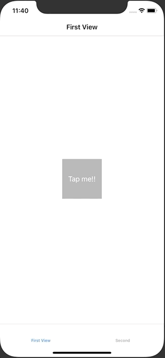

+++
title =  "UserDefaults に配列を保存してTableViewに表示する"
url = "2020-06-27"
date = "2020-06-27"
description = "UserDefaults に配列を保存してTableViewに表示する"
tags = ["iOS", "Swift", "UIKit"]
categories = ["iOS", "Swift"]
archives = "2020/06"
+++

<br>

UserDefaults に配列を保存してTableViewに表示する方法です。
FirstViewController のボタンを押すと UserDefaults に現在の時刻が文字列として保存されます。
SecondViewController を表示すると UserDefaults のデータが読み込まれ、テーブルに表示されます。



<!-- Google Ads -->


<!-- Amazon Ads -->


<!--more-->

**FirstViewController.swift**

```swift
import UIKit

class FirstViewController: UIViewController {

    override func viewDidLoad() {
        super.viewDidLoad()
        
        title = "First View"
        view.backgroundColor = .white
        
        // UserDefaults
        UserDefaults.standard.register(defaults: ["data" : []])
        
        let firstButton = UIButton()
        firstButton.backgroundColor = .lightGray
        firstButton.setTitle("Tap me!!", for: .normal)
        firstButton.frame.size = CGSize(width: 100, height: 100)
        firstButton.center = view.center
        view.addSubview(firstButton)

        firstButton.addTarget(self, action: #selector(tapped), for: .touchUpInside)
    }
    
    @objc func tapped() {
        guard var data = UserDefaults.standard.array(forKey: "data") as? [String] else {
            return
        }
        data.append(Date().description)
        UserDefaults.standard.set(data, forKey: "data")
        print(data)
    }
}
```


**SceneDelegate.swift**

```swift
import UIKit

class SceneDelegate: UIResponder, UIWindowSceneDelegate {

    var window: UIWindow?


    func scene(_ scene: UIScene, willConnectTo session: UISceneSession, options connectionOptions: UIScene.ConnectionOptions) {
        guard let windowScene = (scene as? UIWindowScene) else { return }
        
        // ページを格納する配列
        var viewControllers: [UIViewController] = []

        let firstViewController = FirstViewController()
        firstViewController.tabBarItem = UITabBarItem(title: "First", image: UIImage(), tag: 1)
        let firstNavigationController = UINavigationController(rootViewController: firstViewController)
        viewControllers.append(firstNavigationController)

        let secondViewController = SecondViewController()
        secondViewController.tabBarItem = UITabBarItem(title: "Second", image: UIImage(), tag: 2)
        let secondNavigationController = UINavigationController(rootViewController: secondViewController)
        viewControllers.append(secondNavigationController)

        let tabBarController = UITabBarController()
        tabBarController.setViewControllers(viewControllers, animated: false)

        window = UIWindow(frame: UIScreen.main.bounds)
        window?.rootViewController = tabBarController
        window?.makeKeyAndVisible()
        window?.windowScene = windowScene
    }

    func sceneDidDisconnect(_ scene: UIScene) {
        // Called as the scene is being released by the system.
        // This occurs shortly after the scene enters the background, or when its session is discarded.
        // Release any resources associated with this scene that can be re-created the next time the scene connects.
        // The scene may re-connect later, as its session was not neccessarily discarded (see `application:didDiscardSceneSessions` instead).
    }

    func sceneDidBecomeActive(_ scene: UIScene) {
        // Called when the scene has moved from an inactive state to an active state.
        // Use this method to restart any tasks that were paused (or not yet started) when the scene was inactive.
    }

    func sceneWillResignActive(_ scene: UIScene) {
        // Called when the scene will move from an active state to an inactive state.
        // This may occur due to temporary interruptions (ex. an incoming phone call).
    }

    func sceneWillEnterForeground(_ scene: UIScene) {
        // Called as the scene transitions from the background to the foreground.
        // Use this method to undo the changes made on entering the background.
    }

    func sceneDidEnterBackground(_ scene: UIScene) {
        // Called as the scene transitions from the foreground to the background.
        // Use this method to save data, release shared resources, and store enough scene-specific state information
        // to restore the scene back to its current state.
    }


}

```


**SecondViewController.swift**

```swift
import UIKit

class SecondViewController: UIViewController {
    
    private lazy var tableView: UITableView = UITableView()
    var data: [String] = []
    
    override func viewDidLoad() {
        super.viewDidLoad()
        
        title = "Second View"
        view.backgroundColor = .green
        
        tableView.frame = view.bounds
        tableView.register(UITableViewCell.self, forCellReuseIdentifier: NSStringFromClass(UITableViewCell.self))
        tableView.dataSource = self
        view.addSubview(tableView)
    }
    
    override func viewWillAppear(_ animated: Bool) {
        super.viewWillAppear(animated)
        guard let data = UserDefaults.standard.array(forKey: "data") as? [String] else {
            return
        }
        self.data = data.sorted().reversed()
        tableView.reloadData()
    }
}

extension SecondViewController: UITableViewDataSource {
    func tableView(_ tableView: UITableView, numberOfRowsInSection section: Int) -> Int {
        return data.count
    }
    
    func tableView(_ tableView: UITableView, cellForRowAt indexPath: IndexPath) -> UITableViewCell {
        let cell = tableView.dequeueReusableCell(withIdentifier: NSStringFromClass(UITableViewCell.self))! as UITableViewCell
        cell.textLabel?.text = data[indexPath.row]
        return cell
    }
}

```

