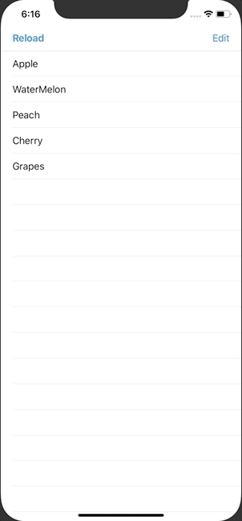

+++
title =  "削除、セルの移動が可能なUITableViewを作る"
url = "2020-07-01"
date = "2020-07-01"
description = "削除、セルの移動が可能なUITableViewを作る"
tags = ["iOS", "Swift", "UIKit"]
categories = ["iOS", "Swift"]
archives = "2020/07"
+++

<br>

削除、セルの移動が可能なUITableViewを作る方法です。
TableViewを使うと簡単に編集可能なTableViewを作ることができます。



<!-- Google Ads -->


<!-- Amazon Ads -->


<!--more-->

**ViewController.swift**

```swift
import UIKit

class ViewController: UIViewController {
    private lazy var myTableView: UITableView = UITableView()
    private var fruits: [String] = []
    
    override func viewDidLoad() {
        super.viewDidLoad()
        
        // set fruits
        fruits = ["Apple", "WaterMelon", "Peach", "Cherry", "Grapes"]
        
        // set delegate
        myTableView.delegate = self
        myTableView.dataSource = self
        
        // set tableview size
        myTableView.frame = view.bounds
        
        // set tableview
        myTableView.register(UITableViewCell.self, forCellReuseIdentifier: NSStringFromClass(UITableViewCell.self))
        view.addSubview(myTableView)
        
        // set editButton
        navigationItem.leftBarButtonItem = UIBarButtonItem(title: "Reload", style: .done, target: self, action: #selector(redo))
        navigationItem.rightBarButtonItem = editButtonItem
    }
    
    // called when the edit button is tapped
    override func setEditing(_ editing: Bool, animated: Bool) {
        super.setEditing(editing, animated: animated)
        myTableView.setEditing(editing, animated: animated)
    }
    
    @objc func redo() {
        myTableView.reloadData()
    }
}


extension ViewController: UITableViewDelegate {
    
    // select
    func tableView(_ tableView: UITableView, didSelectRowAt indexPath: IndexPath) {
        print("\(indexPath.row) row did select")
    }
    
    // edit
    func tableView(_ tableView: UITableView, commit editingStyle: UITableViewCell.EditingStyle, forRowAt indexPath: IndexPath) {
        fruits.remove(at: indexPath.row)
        myTableView.deleteRows(at: [indexPath], with: .fade)
    }
    
    // enable move
    func tableView(_ tableView: UITableView, canMoveRowAt indexPath: IndexPath) -> Bool {
        return true
    }
    
    // move
    func tableView(_ tableView: UITableView, moveRowAt sourceIndexPath: IndexPath, to destinationIndexPath: IndexPath) {
        let fruit = fruits[sourceIndexPath.row]
        fruits.remove(at: sourceIndexPath.row)
        fruits.insert(fruit, at: destinationIndexPath.row)
    }
}

extension ViewController: UITableViewDataSource {
    
    // number of rows
    func tableView(_ tableView: UITableView, numberOfRowsInSection section: Int) -> Int {
        return fruits.count
    }
    
    // cell for row
    func tableView(_ tableView: UITableView, cellForRowAt indexPath: IndexPath) -> UITableViewCell {
        let cell: UITableViewCell = tableView.dequeueReusableCell(withIdentifier: NSStringFromClass(UITableViewCell.self))!
        cell.textLabel?.text = fruits[indexPath.row]
        return cell
    }
}
```

