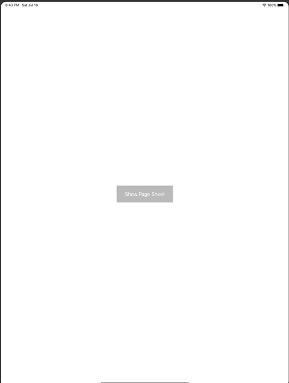

+++
title =  "iPadでモーダルのサイズを取得する"
url = "2020-07-02"
date = "2020-07-02"
description = "iPadでモーダルのサイズを取得する"
tags = ["iOS", "Swift"]
categories = ["iOS", "Swift"]
archives = "2020/07"
+++

<br>

iPadでモーダルのサイズを取得する方法です。
viewWillLayoutSubviews でモーダルのサイズを取得することができます。



<!-- Google Ads -->


<!-- Amazon Ads -->


<!--more-->

**ViewController.swift**

```swift
import UIKit

class ViewController: UIViewController {
    
    override func viewDidLoad() {
        super.viewDidLoad()
        
        print("width=\(view.bounds.size), height=\(view.bounds.height)")
        
        let button = UIButton()
        button.setTitle("Show Page Sheet", for: .normal)
        button.frame.size = CGSize(width: 200, height: 60)
        button.backgroundColor = .lightGray
        button.center = view.center
        button.addTarget(self, action: #selector(showSecondViewPageSheet), for: .touchUpInside)
        view.addSubview(button)
    }
    
    @objc func showSecondViewPageSheet() {
        let viewController = SecondViewController()
        present(viewController, animated: true)
    }
}

class SecondViewController: UIViewController {
    lazy var label = UILabel()
    override func viewDidLoad() {
        super.viewDidLoad()
        
        print("width=\(view.bounds.width), height=\(view.bounds.height)")
        
        view.backgroundColor = .white        
        label.textAlignment = .center
        view.addSubview(label)
    }
    
    override func viewWillLayoutSubviews() {
        print("width=\(view.bounds.width), height=\(view.bounds.height)")
        
        label.text = "width=\(view.bounds.width), height=\(view.bounds.height)"
        label.sizeToFit()
        label.center = view.center
    }
}
```

