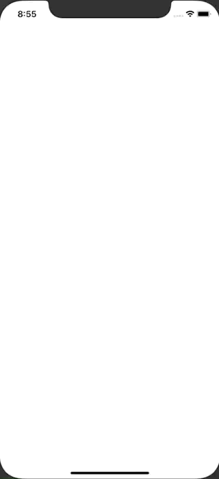

+++
title =  "UIGestureRecognizer でジェスチャーイベントを取得する"
url = "2020-08-01"
date = "2020-08-01"
description = "UIGestureRecognizer でジェスチャーイベントを取得する"
tags = ["iOS", "Swift", "UIKit"]
categories = ["iOS", "Swift"]
archives = "2020/08"
+++

<br>

UIGestureRecognizer でジェスチャーイベントを取得する方法です。
UITapGestureRecognizer, UIPinchGestureRecognizer, UILongPressGestureRecognizer, UISwipeGestureRecognizer などを使ってスワイプ、ピンチなどのイベントを取得することができます。



<!-- Google Ads -->


<!-- Amazon Ads -->


<!--more-->

**ViewController.swift**

```swift
import UIKit

class ViewController: UIViewController {
    
    let label = UILabel()
    
    var tapGesture: UITapGestureRecognizer!
    var pinchGesture: UIPinchGestureRecognizer!
    var longTapGesture: UILongPressGestureRecognizer!
    var swipeGestureUp: UISwipeGestureRecognizer!
    var swipeGestureUpTwo: UISwipeGestureRecognizer!
    var swipeGestureLeft: UISwipeGestureRecognizer!
    var swipeGestureLeftTwo: UISwipeGestureRecognizer!
    var swipeGestureRight: UISwipeGestureRecognizer!
    var swipeGestureRightTwo: UISwipeGestureRecognizer!
    var swipeGestureDown: UISwipeGestureRecognizer!
    var swipeGestureDownTwo: UISwipeGestureRecognizer!
    
    override func viewDidLoad() {
        super.viewDidLoad()
        
        view.addSubview(label)
        
        // Tap
        tapGesture = UITapGestureRecognizer(target: self,action: #selector(ViewController.tap))
        view.addGestureRecognizer(tapGesture)
        
        // Pinch
        pinchGesture = UIPinchGestureRecognizer(target: self, action: #selector(ViewController.pinch))
        view.addGestureRecognizer(pinchGesture)
        
        // Long Tap
        longTapGesture = UILongPressGestureRecognizer(target: self, action: #selector(ViewController.longTap))
        view.addGestureRecognizer(longTapGesture)
        
        // Swipe Up
        swipeGestureUp = UISwipeGestureRecognizer(target: self, action: #selector(ViewController.swipeUp))
        swipeGestureUp.direction = .up
        view.addGestureRecognizer(swipeGestureUp)
        
        // Swipe Up Two
        swipeGestureUpTwo = UISwipeGestureRecognizer(target: self, action: #selector(ViewController.swipeUpTwo))
        swipeGestureUpTwo.direction = .up
        swipeGestureUpTwo.numberOfTouchesRequired = 2
        view.addGestureRecognizer(swipeGestureUpTwo)
        
        // Swipe Left
        swipeGestureLeft = UISwipeGestureRecognizer(target: self, action: #selector(ViewController.swipeLeft))
        swipeGestureLeft.direction = .left
        view.addGestureRecognizer(swipeGestureLeft)
        
        // Swipe Left Two
        swipeGestureLeftTwo = UISwipeGestureRecognizer(target: self, action: #selector(ViewController.swipeLeftTwo))
        swipeGestureLeftTwo.direction = .left
        swipeGestureLeftTwo.numberOfTouchesRequired = 2
        view.addGestureRecognizer(swipeGestureLeftTwo)
        
        // Swipe Right
        swipeGestureRight = UISwipeGestureRecognizer(target: self, action: #selector(ViewController.swipeRight))
        swipeGestureRight.direction = .right
        view.addGestureRecognizer(swipeGestureRight)
        
        // Swipe Right Two
        swipeGestureRightTwo = UISwipeGestureRecognizer(target: self, action: #selector(ViewController.swipeRightTwo))
        swipeGestureRightTwo.direction = .right
        swipeGestureRightTwo.numberOfTouchesRequired = 2
        view.addGestureRecognizer(swipeGestureRightTwo)
        
        // Swipe Down
        swipeGestureDown = UISwipeGestureRecognizer(target: self, action: #selector(ViewController.swipeDown))
        swipeGestureDown.direction = .down
        view.addGestureRecognizer(swipeGestureDown)
        
        // Swipe Down Two
        swipeGestureDownTwo = UISwipeGestureRecognizer(target: self, action: #selector(ViewController.swipeDownTwo))
        swipeGestureDownTwo.direction = .down
        swipeGestureDownTwo.numberOfTouchesRequired = 2
        view.addGestureRecognizer(swipeGestureDownTwo)
    }
    
    @objc func tap(_ sender: UITapGestureRecognizer) {
        print("Tap")
        setLabel(text: "Tap")
    }
    
    @objc func pinch(_ sender: UIPinchGestureRecognizer) {
        print("Pinch")
        setLabel(text: "Pinch")
    }
    
    @objc func longTap(_ sender: UILongPressGestureRecognizer) {
        print("Long Tap")
        setLabel(text: "Long Tap")
    }
    
    @objc func swipeUp(_ sender: UISwipeGestureRecognizer) {
        print("Swipe Up")
        setLabel(text: "Swipe Up")
    }
    
    @objc func swipeUpTwo(_ sender: UISwipeGestureRecognizer) {
        print("Swipe Up Two")
        setLabel(text: "Swipe Up Two")
    }
    
    @objc func swipeLeft(_ sender: UISwipeGestureRecognizer) {
        print("Swipe Left")
        setLabel(text: "Swipe Left")
    }
    
    @objc func swipeLeftTwo(_ sender: UISwipeGestureRecognizer) {
        print("Swipe Left Two")
        setLabel(text: "Swipe Left Two")
    }
    
    @objc func swipeRight(_ sender: UISwipeGestureRecognizer) {
        print("Swipe Right")
        setLabel(text: "Swipe Right")
    }
    
    @objc func swipeRightTwo(_ sender: UISwipeGestureRecognizer) {
        print("Swipe Right Two")
        setLabel(text: "Swipe Right Two")
    }
    
    @objc func swipeDown(_ sender: UISwipeGestureRecognizer) {
        print("Swipe Down")
        setLabel(text: "Swipe Down")
    }
    
    @objc func swipeDownTwo(_ sender: UISwipeGestureRecognizer) {
        print("Swipe Down Two")
        setLabel(text: "Swipe Down Two")
    }
    
    private func setLabel(text: String) {
        label.text = text
        label.sizeToFit()
        label.textAlignment = .center
        label.center = view.center
    }
}
```

