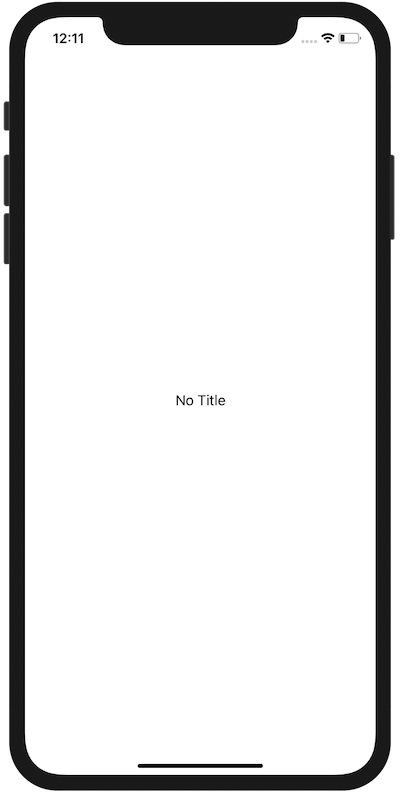

+++
title =  "SwiftUIでNavigationBarを隠す"
url = "2020-08-02"
date = "2020-08-02"
description = "SwiftUIでNavigationBarを隠す"
tags = ["iOS", "Swift", "SwiftUI"]
categories = ["iOS", "Swift", "SwiftUI"]
archives = "2020/08"
+++

<br>

SwiftUI で NavigationBar を隠す方法です。
<code>.navigationBarHidden(true)</code> を設定すると隠すことができます。
理由は不明ですが、空文字で仮のタイトルを設定する必要がありました。



<!-- Google Ads -->


<!-- Amazon Ads -->


<!--more-->

**ContentView.swift**

```swift
import SwiftUI

struct ContentView: View {    
    var body: some View {
        NavigationView {
            Text("No Title")
                .navigationBarTitle("")
                .navigationBarHidden(true)
        }
    }
}
```

