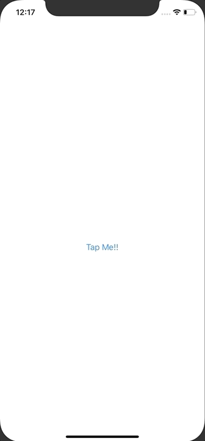

+++
title =  "Buttonからプッシュ遷移をする（NavigationLinkを無効にする）"
url = "2020-08-03"
date = "2020-08-03"
description = "Buttonからプッシュ遷移をする（NavigationLinkを無効にする）"
tags = ["iOS", "Swift", "SwiftUI"]
categories = ["iOS", "Swift", "SwiftUI"]
archives = "2020/08"
+++

<br>

Buttonからプッシュ遷移をする方法です。
この方法であれば、NavigationLink を擬似的に無効にすることができます。




<!-- Google Ads -->


<!-- Amazon Ads -->


<!--more-->

**ContentView.swift**

```swift
import SwiftUI

struct ContentView: View {
    @State var isActive = false

    var body: some View {
        NavigationView {
            VStack {
                Button(action: {
                    self.isActive = true
                }) {
                    Text("Tap Me!!")
                }

                NavigationLink(destination: Text("SecondView"), isActive: $isActive) {
                    EmptyView()
                }
            }
        }
    }
}
```

