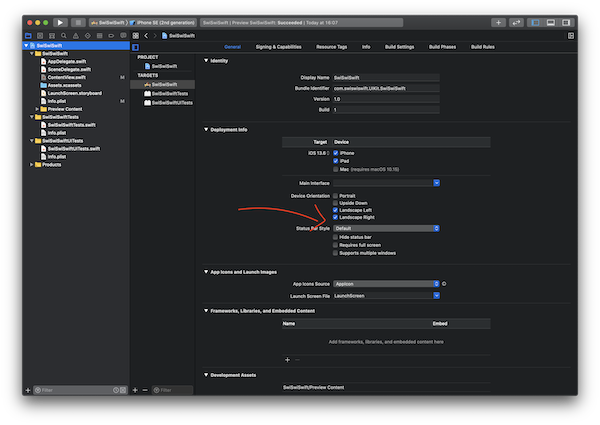
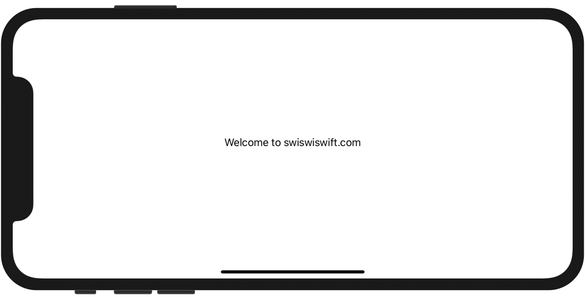
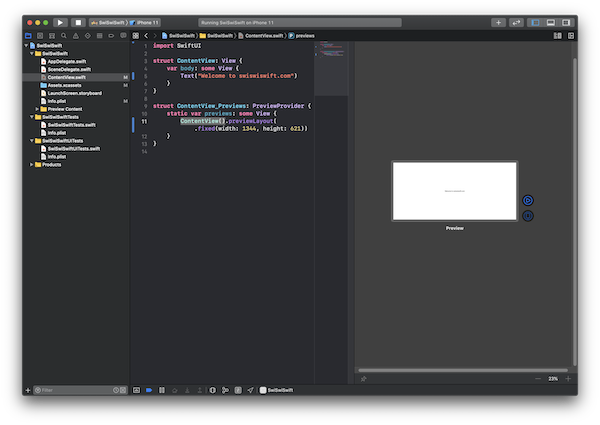

+++
title =  "SwiftUIのPreviewを横向きにする"
url = "2020-08-04"
date = "2020-08-04"
description = "SwiftUIのPreviewを横向きにする"
tags = ["iOS", "Swift", "SwiftUI"]
categories = ["iOS", "Swift", "SwiftUI"]
archives = "2020/08"
+++

<br>

SwiftUIのPreviewを横向きにする方法です。
Previewのサイズを変更することで実現しました。

Landscape Right, Landscape Left にチェックを入れアプリを横向きにします。



Previewのサイズを端末のサイズに変更します。






<!-- Google Ads -->


<!-- Amazon Ads -->


<!--more-->

**ContentView.swift**

```swift
import SwiftUI

struct ContentView: View {
    var body: some View {
        Text("Welcome to swiswiswift.com")
    }
}

struct ContentView_Previews: PreviewProvider {
    static var previews: some View {
        ContentView().previewLayout(.fixed(width: 1344, height: 621))
    }
}
```

