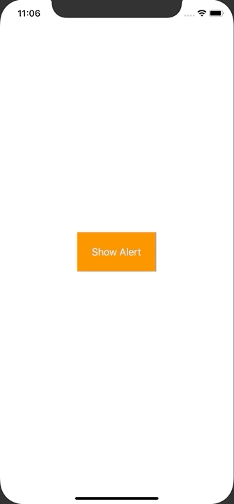

+++
title =  "UIAlertControllerでアラートを表示する"
url = "2020-08-05"
date = "2020-08-05"
description = "UIAlertControllerでアラートを表示する"
tags = ["iOS", "Swift", "UIKit"]
categories = ["iOS", "Swift"]
archives = "2020/08"
+++

<br>

UIAlertControllerを使ってアラートを出すサンプルです。
<code>UIAlertControllerStyle.alert</code> を <code>UIAlertControllerStyle.actionSheet</code> にするとニュッと下から出るタイプのアラートになります。




<!-- Google Ads -->


<!-- Amazon Ads -->


<!--more-->

**ViewController.swift**

```swift
import UIKit

class ViewController: UIViewController {
    
    override func viewDidLoad() {
        super.viewDidLoad()
        
        view.backgroundColor = .white
        
        // alert button
        let showAlertButton = UIButton()
        showAlertButton.frame.size = CGSize(width: 140, height: 70)
        showAlertButton.center = view.center
        showAlertButton.backgroundColor = UIColor.orange
        showAlertButton.setTitle("Show Alert", for: UIControl.State.normal)
        showAlertButton.setTitleColor(UIColor.white, for: UIControl.State.normal)
        showAlertButton.addTarget(self, action: #selector(showAlert(sender:)), for:.touchUpInside)
        view.addSubview(showAlertButton)
    }
    
    @objc func showAlert(sender: UIButton){
        let alertController = UIAlertController(title: "Pokemon List", message: "Select your favorite pokemon.", preferredStyle: UIAlertController.Style.alert)
        
        let shorlaxAction = UIAlertAction(title: "Snorlax", style: UIAlertAction.Style.default, handler: { action in
            print("Snorlax was selected")
        })
        alertController.addAction(shorlaxAction)
        
        let pikachuAction = UIAlertAction(title: "Pikachu", style: UIAlertAction.Style.default, handler: { action in
            print("Pikachu was selected")
        })
        alertController.addAction(pikachuAction)
        
        let cancelAction = UIAlertAction(title: "Cancel", style: UIAlertAction.Style.cancel, handler: { action in
            print("Cancel was selectd")
        })
        alertController.addAction(cancelAction)
        
        present(alertController, animated: true, completion: nil)
    }
}
```

