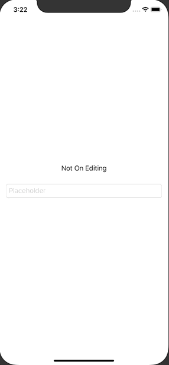

+++
title =  "SwiftUIのTextFieldで編集中と編集完了を検知する"
url = "2020-08-06"
date = "2020-08-06"
description = "SwiftUIのTextFieldで編集中と編集完了を検知する"
tags = ["iOS", "Swift", "SwiftUI"]
categories = ["iOS", "SwiftUI"]
archives = "2020/08"
+++

<br>

SwiftUIのTextFieldで編集中と編集完了を検知する方法です。
UIKit よりも少ないコードで実現できている気がします。




<!-- Google Ads -->


<!-- Amazon Ads -->


<!--more-->

**ContentView.swift**

```swift
import SwiftUI

struct ContentView : View {
    @State var userName: String = ""
    @State var onEditing: Bool = false
    var body: some View {
        VStack {
            Text(onEditing ? "On Editing" : "Not On Editing")
            
            TextField("Placeholder", text: $userName, onEditingChanged: { onEditing in
                print("onEditingChanged: \(onEditing)")
                self.onEditing = onEditing
            }, onCommit: {
                print("onCommit")
            })
                .textFieldStyle(RoundedBorderTextFieldStyle())
                .padding()
        }
    }
}
```

